# Architecture

**Project:** Spice & Saffron — Multi-Tenant Indian Café & Restaurant Commerce + Operations Platform
**Owner:** Himanshu ([@Himanshusingh204](https://github.com/Himanshusingh204) · himanshuyt21361@gmail.com)
**Document status:** Living architecture reference — reviewed at the start of every phase
**Last updated:** 2026-10-15
**Companion documents:** [Master Plan](./MASTER_PLAN.md) · [Database](./DATABASE.md) · [Audit](./AUDIT.md) · [Roadmap](./ROADMAP.md) · [Operations](./OPERATIONS.md) · [Testing](./TESTING.md) · [SEO & Performance](./SEO-AND-PERFORMANCE.md) · [ADRs](./adr/) · [Security Policy](../SECURITY.md)

---

## Table of contents

1. [Conventions and terminology](#1-conventions-and-terminology)
2. [Context and goals](#2-context-and-goals)
3. [System context](#3-system-context)
4. [Container and component model](#4-container-and-component-model)
5. [Data flows](#5-data-flows)
   - 5.1 [Storefront page read](#51-storefront-page-read-cdn--isr--rsc--cache--db)
   - 5.2 [Order creation write path](#52-order-creation-write-path-the-money-path)
   - 5.3 [Payment webhook ingress](#53-payment-webhook-ingress)
   - 5.4 [KDS realtime fan-out](#54-kds-realtime-fan-out)
   - 5.5 [Admin CMS mutation](#55-admin-cms-mutation)
6. [Networking design](#6-networking-design)
7. [Runtime placement matrix](#7-runtime-placement-matrix)
8. [Two-runtime adapter contract](#8-two-runtime-adapter-contract)
9. [Scaling model](#9-scaling-model)
10. [Failure modes and degradation](#10-failure-modes-and-degradation)
11. [Cross-cutting concerns](#11-cross-cutting-concerns)
12. [Known defects and remediation phases](#12-known-defects-and-remediation-phases)
13. [Architecture Decision Record index](#13-architecture-decision-record-index)
14. [Footer](#14-footer)

---

## 1. Conventions and terminology

This document deliberately separates **what exists in the repository today** from
**the agreed target design**. Nothing in this document should be read as a claim
that an unbuilt component exists.

| Marker | Meaning |
| :--- | :--- |
| **[BUILT]** | Verified present in the working tree on 2026-10-15. Line references are to actual files. |
| **[TARGET]** | Agreed direction from [MASTER_PLAN.md](./MASTER_PLAN.md). **Not implemented.** |
| **[RECOMMENDATION]** | Engineering advice from this document; not yet ratified as a decision. |

**Stack (verified):** Next.js `16.3.1` (App Router) · React `19.2.8` · TypeScript
strict · Tailwind CSS v4 · Prisma `7.9.1` with `@prisma/adapter-pg` · PostgreSQL
18 · Express `5.2.1` standalone API · Zod 4 · Argon2id · Vercel hosting target ·
optional Upstash Redis. **26 Prisma models.** `proxy.ts` at the repository root is
the Next 16 replacement for `middleware.ts`.

**Quality gates (measured):** `npx tsc --noEmit` clean · `npm run lint` clean ·
`npx vitest run` = **192 tests / 31 files** · `npm run build` succeeds with
**40 routes** and **no module-not-found warnings** (the `@vercel/blob` import was
removed in Phase 1). One advisory remains: `db.slow_query` — `Dish.findMany` at
**195 ms**.

**Vocabulary**

| Term | Definition |
| :--- | :--- |
| **Tenant** | One restaurant brand/venue. Isolation boundary for catalog, orders, users and content. |
| **Adapter** | A thin transport binding (Route Handler, Server Action, Express route) that contains no business rules. |
| **Service** | A module under `lib/services/*` owning one bounded context's rules and transactions. |
| **Outbox** | A database table of pending side-effect intents, committed atomically with the domain write. |
| **Money path** | Any code that influences a price, total, tax, discount or loyalty accrual. |
| **Runtime** | A process that executes the codebase: Vercel Node function, standalone Express process, or worker. |

---

## 2. Context and goals

### 2.1 Product context

Spice & Saffron is a **multi-tenant restaurant commerce and operations
platform**. It serves two distinct audiences from one codebase:

- A **customer storefront** — menu, cart, checkout, order tracking,
  reservations, waitlist and loyalty.
- An **operations back office** — kitchen display (KDS), floor plan, inventory,
  dispatch, CMS, audit and reporting.

It is proprietary software, licensed for the owner's personal use
([LICENSE](../LICENSE)). It is not currently sold as a SaaS; multi-tenant
isolation is nonetheless a first-class architectural concern because the schema
and the plan both support 100+ tenants ([MASTER_PLAN.md §5](./MASTER_PLAN.md)).

### 2.2 Architectural goals

| # | Goal | Success criterion |
| :-- | :--- | :--- |
| G1 | **Deployability** | The documented API is reachable in production on Vercel; uploads never write binary into Postgres. |
| G2 | **One domain, two runtimes** | Route Handlers and Express are thin adapters over `lib/services/*`; contract tests prove byte-compatible responses. |
| G3 | **No correctness in process memory** | Cache, rate limit, idempotency and pub/sub are Redis-backed in production; the queue is a durable DB outbox. |
| G4 | **Fail closed** | Unknown tenant → `404`. Unverifiable signature → `401`. Missing price → reject. Never silently fall back. |
| G5 | **Data integrity** | `tenantId NOT NULL`, composite indexes for real query shapes, `Decimal(10,2)` money. |
| G6 | **Graceful degradation** | Cache outage slows the system, never fails an order. |
| G7 | **Measurability** | Every performance and reliability claim is backed by a number (`EXPLAIN`, Lighthouse, k6, logs). |

### 2.3 Non-goals

| Non-goal | Rationale |
| :--- | :--- |
| **Microservices / service mesh** | One deployable application is correct at this scale. The service layer already gives logical boundaries without network hops. |
| **A monorepo** | No shared packages exist that justify the tooling cost. Single repository, single `package.json`. |
| **A `src/` directory move** | Churn without value. The App Router layout is idiomatic and stays. |
| **Kubernetes / multi-region active-active** | Vercel + a managed Postgres and Redis cover the stated capacity target with far less operational surface. |
| **Sharding by tenant** | Held in reserve (see [§9](#9-scaling-model)); premature at 100 tenants. |
| **A separate mobile app backend** | The same `app/api/v1/*` surface serves B2B and mobile clients. |
| **Event sourcing** | The outbox + audit log give the needed durability and history without the operational cost. |
| **Full offline-first KDS** | Reconnect + resync ([§5.4](#54-kds-realtime-fan-out)) is sufficient; true offline sync is out of scope. |
| **Supporting IE / legacy browsers** | Modern evergreen targets only. |

---

## 3. System context

Spice & Saffron is a single logical system with six external actors. Two are
human-facing web clients, one is a live streaming client, one is a machine
partner, and two are outbound third-party dependencies.

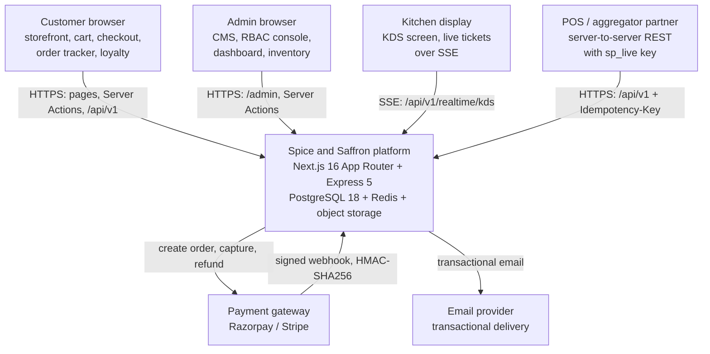

| Actor | Trust level | Primary interface | Auth |
| :--- | :--- | :--- | :--- |
| Customer browser | Untrusted | RSC pages, Server Actions, `app/api/v1/*` | Session cookie (customer) or anonymous |
| Admin browser | Semi-trusted | `app/admin/*`, Server Actions | `cafe_session` cookie + RBAC |
| Kitchen display | Semi-trusted | `app/api/v1/realtime/kds` (SSE) | Session / scoped key + connection cap |
| POS / aggregator | Machine | `app/api/v1/*` (Express on self-host) | `sp_live_…` S2S key with scopes |
| Payment gateway | Trusted-with-verification | Webhook ingress | HMAC-SHA256 signature + timestamp |
| Email provider | Trusted outbound | Worker → provider API | API key (secret-scoped) |

**Boundary rules**

1. Every trust boundary terminates in a **Zod parse** and an **authorisation
   check** before domain code runs.
2. The gateway is never trusted on the strength of the request alone — the HMAC
   signature and event id are verified before any state change.
3. No external actor reaches the database directly; all access flows through
   `lib/services/*`.

---

## 4. Container and component model

The system is organised as six layers. The rule is directional: **L1 → L2 → L3 →
L4 → L5**. A layer never calls upward, and a domain service never constructs a
transport concern.

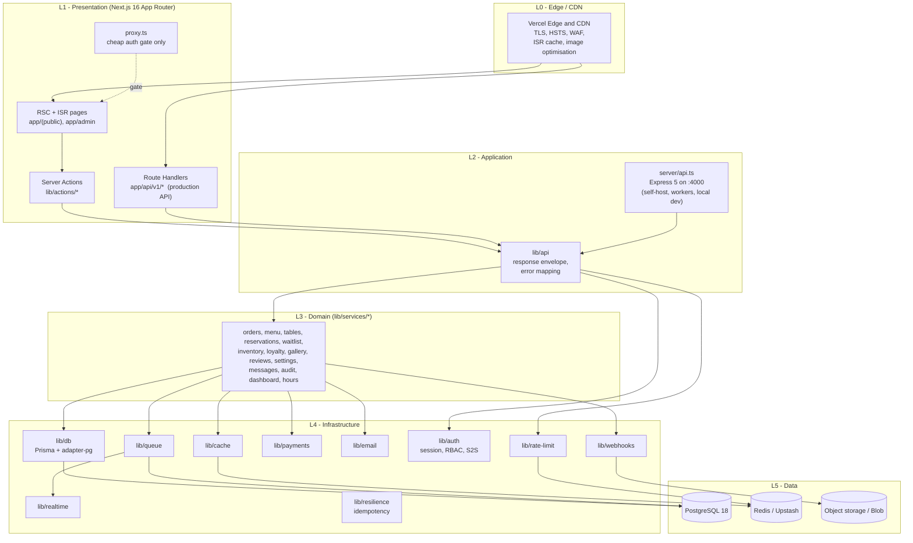

### 4.1 Layer responsibilities

| Layer | Owns | Never does |
| :--- | :--- | :--- |
| **L0 Edge** | TLS termination, HSTS, security headers, CDN/ISR caching, image transforms, coarse bot mitigation | Business logic, auth decisions |
| **L1 Presentation** | Routing, rendering, streaming, form entry, `proxy.ts` early gate | Direct Prisma access, pricing, authorisation as the only guard |
| **L2 Application** | Request parsing, Zod validation, authN/authZ, rate limiting, response envelope, error → HTTP mapping | Business rules, transaction boundaries |
| **L3 Domain** | Business invariants, transaction orchestration, pricing, coupons, inventory, loyalty, audit | HTTP types, headers, cookies, framework imports |
| **L4 Infrastructure** | Persistence, cache, queue, pub/sub, payments, email, webhooks, crypto, telemetry | Domain decisions |
| **L5 Data** | Durable storage, caching, object blobs | — |

### 4.2 Infrastructure modules [BUILT]

| Module | Path | Responsibility |
| :--- | :--- | :--- |
| Persistence | `lib/db/prisma.ts` | Single Prisma client via `PrismaPg`, slow-query telemetry at >150 ms |
| Tenancy | `lib/db/tenant.ts` | `resolveTenant()`, default-tenant bootstrap |
| Cache | `lib/cache/cache-manager.ts` | Cache-aside with Upstash path **and** silent memory fallback |
| Queue | `lib/queue/job-queue.ts` | In-memory array + `setInterval` worker; handlers in `lib/queue/handlers.ts` |
| Realtime | `lib/realtime/bus.ts` | In-process `EventEmitter` |
| Idempotency | `lib/resilience/idempotency.ts` | Redis path **and** memory fallback |
| Rate limiting | `lib/rate-limit/limiter.ts` | In-memory `Map` store |
| Payments | `lib/payments/engine.ts` | Razorpay + Stripe abstraction, HMAC webhook verification, sandbox simulation |
| Email | `lib/email/notifier.ts` | Transactional email sender (unit-tested) |
| Auth | `lib/auth/passwords.ts`, `session.ts`, `s2s.ts`, `guards.ts` | Argon2id, hashed sessions, scoped API keys, RBAC guards |
| Webhooks | `lib/webhooks/dispatcher.ts` | Outbound webhook subscription + delivery |
| Config | `config/site.ts`, `limits.ts`, `roles.ts`, `s2s.ts`, `seo.ts`, `navigation.ts` | Typed, single-source configuration |

### 4.3 Where the design concentrates its risk

Every [BUILT] infrastructure module that holds **state** holds it in process
memory: `lib/realtime/bus.ts:24` (`new EventEmitter()`),
`lib/queue/job-queue.ts:26` (in-memory array) and `:83` (`setInterval` worker),
`lib/rate-limit/limiter.ts:12` (`new Map()`), and
`lib/cache/cache-manager.ts:11` (`new Map()`). On a single-node local process
this is coherent; on serverless or behind two instances it silently diverges.
This is the single largest correctness defect in the system
([§12](#12-known-defects-and-remediation-phases), [AUDIT.md P0-2](./AUDIT.md)).

---

## 5. Data flows

Five flows carry the system's correctness: the read path, the money path, the
payment ingress, the realtime fan-out, and the admin mutation. Each is shown as
a sequence diagram plus a numbered step list, and each closes with the invariant
it must preserve.

### 5.1 Storefront page read (CDN → ISR → RSC → cache → DB)

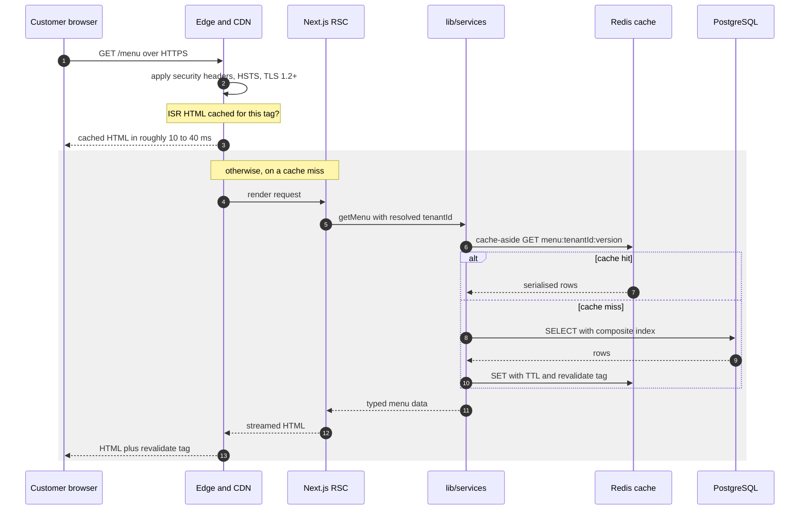

**Steps**

1. The browser issues `GET /menu` over TLS. The edge terminates TLS and applies
   the security header set from `next.config.ts:7-35`.
2. The edge checks its ISR/static cache for the route's cache tag. A hit returns
   pre-rendered HTML with no origin cost.
3. On a miss, the request reaches the Node runtime and React Server Components
   begin rendering.
4. `lib/db/tenant.ts` resolves the tenant for the request. [TARGET] This becomes
   a strict lookup backed by a cache; today an unknown slug silently returns the
   default tenant (`lib/db/tenant.ts:54-67`).
5. The RSC calls a read function in `lib/services/*` (for catalog:
   `lib/services/menu.ts`).
6. The service consults `lib/cache/cache-manager.ts` (cache-aside). [BUILT] The
   Upstash path exists but falls back to a process-local `Map` when Redis is
   absent.
7. On a cache miss the service queries Postgres through the single Prisma client
   in `lib/db/prisma.ts`.
8. The result is serialised back into the cache with a TTL, then rendered.
9. HTML is streamed to the client; the ISR entry is stored under a tag so a
   later mutation can revalidate it.

**As built vs target.** Steps 1–3 and 5–9 are [BUILT]. Step 4's strictness and
Step 6's mandatory Redis are [TARGET]. The 195 ms `Dish.findMany` warning is a
symptom of Step 7 running against a missing composite index
([DATABASE.md](./DATABASE.md), [AUDIT.md P2-2](./AUDIT.md)).

**Invariant:** a cached page must never be served for the wrong tenant. Cache
keys are tenant-scoped and versioned; invalidation is by prefix version, not by
`KEYS` ([AUDIT.md P1-3](./AUDIT.md)).

### 5.2 Order creation write path (the money path)

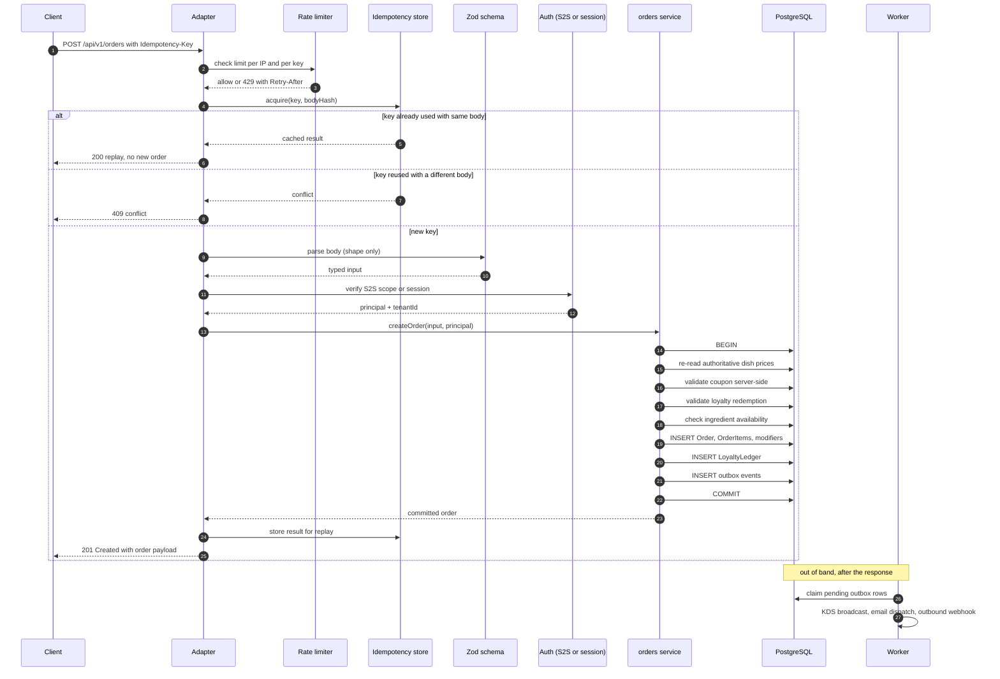

**Steps**

1. **Rate limit.** [TARGET] Redis-backed, keyed per IP **and** per API key.
   [BUILT] Memory-backed, so limits multiply by instance count.
2. **Idempotency.** The `Idempotency-Key` is acquired against a store that
   records the key, a hash of the request body, and the response. Reuse with the
   same body replays; reuse with a different body is a `409`.
   [BUILT] `lib/resilience/idempotency.ts::acquire(key)` — [TARGET] bound to the
   body hash and scoped per tenant/endpoint ([AUDIT.md P1-4](./AUDIT.md)).
3. **Zod parse.** Shape and type validation only. **Pricing is never taken from
   the client.** [BUILT] on the customer path (`lib/services/orders.ts`);
   **broken** on the B2B adapter (`app/api/v1/orders/route.ts:22,93-96`), which
   accepts a client-supplied `price` and sums it ([§12](#12-known-defects-and-remediation-phases)).
4. **Auth.** Session cookie for browsers; `sp_live_…` S2S key with scope
   (`orders:write`) for partners. Verified in `lib/auth/s2s.ts`.
5. **Domain transaction.** `lib/services/orders.ts::createOrder` re-reads every
   price from the database, validates the coupon, validates loyalty redemption,
   checks inventory, inserts the order graph, writes the loyalty ledger, and
   appends outbox rows — all inside one transaction.
6. **Commit and respond.** The response returns as soon as the transaction
   commits. Side effects never block it.
7. **Async side effects.** [TARGET] A worker drains the durable outbox and
   performs KDS broadcast, email dispatch and outbound webhooks. [BUILT] An
   in-process `setInterval` queue that is lost on deploy, and whose
   `EMAIL_DISPATCH` handler only logs (`lib/queue/handlers.ts:65-74`) instead of
   calling `lib/email/notifier.ts`.

**Invariant:** Step 5 is the **only** place a price is decided. Steps 1–4 are
admission control; Step 6 must never be blocked by Step 7. The order payload the
client sends carries *identifiers and quantities*, never amounts.

### 5.3 Payment webhook ingress

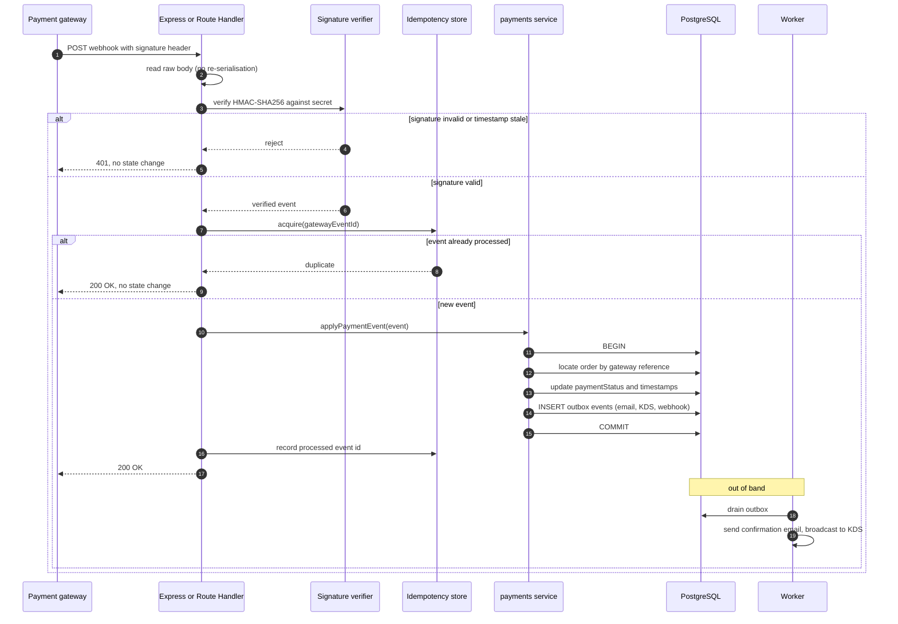

**Steps**

1. The gateway POSTs a signed event. The handler reads the **raw** body — JSON
   re-serialisation would invalidate the signature.
2. HMAC-SHA256 is verified against the configured secret; a stale timestamp is
   rejected. [BUILT] in `lib/payments/engine.ts`.
3. The gateway **event id** is used as an idempotency key. A duplicate delivery
   returns `200` with no state change, so retries are safe.
4. The payments service reconciles the event against the order reference inside a
   single transaction and updates payment state.
5. Outbox rows for customer email, KDS notification and outbound partner webhooks
   are committed atomically with the payment state change.
6. `200 OK` is returned quickly, before side effects run. Gateways retry on
   non-2xx and time out on slow handlers; both must be avoided.

**As built vs target.** Signature verification and the sandbox simulation are
[BUILT]. The durable outbox (Steps 5–6) is [TARGET]. Today the webhook handler
enqueues an `EMAIL_DISPATCH` job whose handler only logs
(`lib/queue/handlers.ts:65-74`), so paying customers receive no confirmation
([AUDIT.md P0-5](./AUDIT.md)).

**Invariant:** a webhook may be delivered more than once, out of order, or not at
all. Processing must be idempotent, and the system must reconcile from its own
state rather than trusting delivery. Never mark an order paid on a gateway
timeout.

### 5.4 KDS realtime fan-out

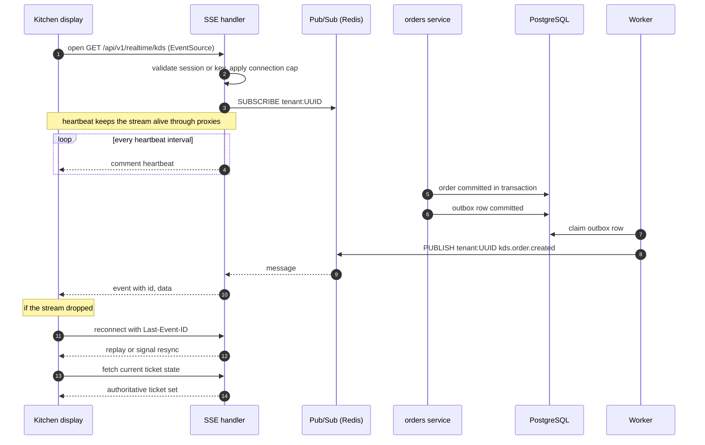

**Steps**

1. The kitchen screen opens an SSE connection to
   `app/api/v1/realtime/kds/route.ts`. [BUILT] A `ReadableStream` with a 20 s
   heartbeat; [TARGET] `runtime = "nodejs"` pinned explicitly (currently not
   pinned) and a per-tenant connection cap.
2. On connect, the server subscribes to the tenant's channel. [BUILT] The
   subscriber registers with a UUID (`app/api/v1/realtime/kds/route.ts:40`).
3. A domain mutation commits an outbox row atomically with the order change.
4. The worker claims the row and publishes to the tenant channel via Redis
   pub/sub. [BUILT] `server/api.ts:287` publishes with
   `tenantId: order.tenantId || "spice-saffron"` — a **slug** — while
   subscribers register with a **UUID**, so the event is never delivered
   ([AUDIT.md P2-8](./AUDIT.md)).
5. The SSE handler writes the event to the open stream with an `id` field.
6. On disconnect, the client reconnects with `Last-Event-ID` and then **re-fetches
   authoritative ticket state** from the API to resync. Replay alone is not
   sufficient; the client must converge on server truth.

**As built vs target.** [BUILT] SSE exists in two places — the Next Route Handler
(20 s heartbeat) and the Express server (`server/api.ts:206`, 25 s heartbeat) —
both subscribing to the **in-process** bus. Consequently a ticket created through
Next.js is invisible to an Express SSE listener even on one machine.
[TARGET] A single Redis pub/sub backbone so either runtime's subscribers see all
events ([MASTER_PLAN.md §4.3](./MASTER_PLAN.md)).

**Invariant:** realtime is an optimisation, never the source of truth. Any client
that misses events must be able to reconverge by re-querying.

### 5.5 Admin CMS mutation

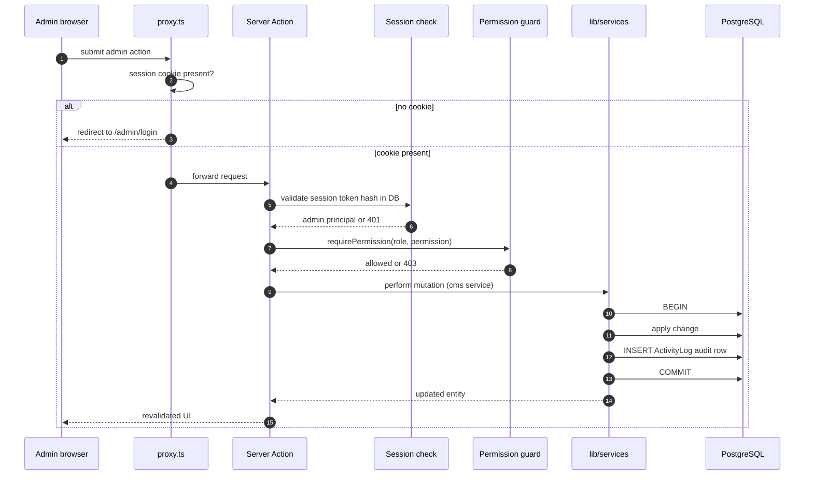

**Steps**

1. `proxy.ts` performs a **cheap** presence check of the `cafe_session` cookie
   and redirects to login when it is absent. It is explicitly documented as a
   first gate, **never the only guard** (`proxy.ts:4-7`).
2. The authoritative check follows: `lib/auth/session.ts` validates the
   SHA-256-hashed session token against the database.
3. `lib/auth/guards.ts::requirePermission` enforces RBAC against
   `config/roles.ts` (`SUPER_ADMIN > ADMIN > EDITOR`).
4. The domain mutation runs in `lib/services/*` inside a transaction.
5. An **immutable audit row** is written to `ActivityLog` in the same
   transaction, so a privileged mutation cannot succeed without leaving a trace.
6. The response is returned and any affected cache tag is revalidated.

**Invariant:** `proxy.ts` is a latency optimisation, not a security control. Every
admin mutation passes both session validation and a permission check server-side,
with a negative test proving a lower role cannot reach a higher-role action
([MASTER_PLAN.md §11](./MASTER_PLAN.md)).

---

## 6. Networking design

This section defines the network behaviour the platform must exhibit. Items
marked [BUILT] are verified present; the rest are [TARGET]/[RECOMMENDATION].

### 6.1 Transport and edge

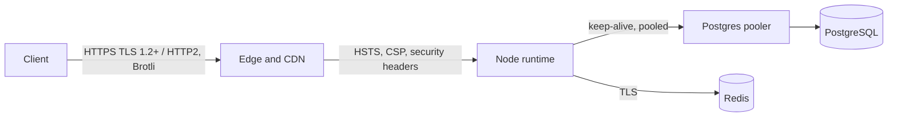

| Control | Setting | Status |
| :--- | :--- | :--- |
| TLS | TLS 1.2+ / 1.3 only; HTTP/2 to the edge | [TARGET] provider-managed; HTTPS enforced |
| HSTS | `max-age=63072000; includeSubDomains; preload` | [BUILT] `next.config.ts:32-34` (ignored over plain HTTP locally) |
| Security headers | `CSP`, `X-Content-Type-Options: nosniff`, `X-Frame-Options: DENY`, `Referrer-Policy: strict-origin-when-cross-origin`, `Permissions-Policy` | [BUILT] `next.config.ts:21-35` |
| CSP | `default-src 'self'`; script allowlist for Razorpay/Stripe; `object-src 'none'`; `frame-ancestors 'none'`; `base-uri 'self'`; `form-action 'self'` | [BUILT] `next.config.ts:7-19`. [TARGET] remove `'unsafe-inline'` for scripts via nonce/`strict-dynamic` |
| Additional headers | `Cross-Origin-Opener-Policy`, `Cross-Origin-Resource-Policy`, `X-DNS-Prefetch-Control` | [TARGET] [MASTER_PLAN.md §11](./MASTER_PLAN.md) |
| Compression | Brotli/gzip at the edge; pre-compressed static assets | [TARGET] edge default |
| Image optimisation | `formats: ["image/avif","image/webp"]` with explicit `deviceSizes`/`imageSizes` | [BUILT] `next.config.ts:39-43` |

### 6.2 CORS

| Environment | Policy |
| :--- | :--- |
| Production | **Strict allowlist** derived from `APP_URL` and explicitly configured partner origins. Unknown origins rejected on credentialed routes. `allowedHeaders` must include `Idempotency-Key`. |
| Development | Permissive is acceptable but must be gated by an explicit env check, never the default branch. |

**Current defect [BUILT]:** `server/api.ts:29-42` returns `callback(null, true)`
on **both** branches while `credentials: true` is set, so the allowlist is
decorative and any origin is echoed. Fix is Phase 4
([AUDIT.md P1-1](./AUDIT.md), [§12](#12-known-defects-and-remediation-phases)).

### 6.3 Timeouts, retries and circuit breaking

| Concern | Value | Rationale |
| :--- | :--- | :--- |
| Outbound gateway call | **10 s** | Below the gateway's own retry window; matches the webhook egress timeout already used in `lib/queue/handlers.ts:50` (`AbortSignal.timeout(10000)`) |
| DB statement | **5 s** | A statement past 5 s is a bug or a lock; fail fast and free the connection |
| Whole route | **30 s** | Upper bound for the request; SSE and workers are exempt |
| Retry policy | GET/idempotent only; exponential backoff **with jitter**, max 3 attempts | Never blind-retry a mutation; jitter prevents thundering herds on failover |
| Circuit breaker | Per dependency (payment gateway, email), open on error threshold, half-open probe | Stop burning the route budget on a down dependency |
| Connection pool | Explicit `max` per runtime — small (1–5) for serverless behind a pooler, 10–20 for the worker | Prevent `max_connections` exhaustion |

[TARGET] All values are configuration, not literals — see
[§11](#11-cross-cutting-concerns). Today `lib/db/prisma.ts:8` constructs a
`PrismaPg` with **no pool bounds, no idle timeout, no connection timeout and no
statement timeout** ([AUDIT.md P1-2](./AUDIT.md)).

### 6.4 Backpressure and load shedding

- Bounded queue depth. When the outbox or worker exceeds its backlog threshold,
  the system **sheds load** with `429` + `Retry-After` rather than collapsing.
- Admission control sits **before** the domain transaction, so shed requests cost
  nothing in the database.
- `lib/api/response.ts::rateLimited` already emits the correct status and
  `Retry-After` header [BUILT].

### 6.5 Server-Sent Events (SSE) specifics

| Requirement | Value | Reason |
| :--- | :--- | :--- |
| Cache control | `Cache-Control: no-cache, no-transform` | Proxies must not buffer or rewrite the stream |
| Heartbeat | Comment line every **20 s** (Next [BUILT]) / **25 s** (Express [BUILT]); [TARGET] standardise | Beat under idle-timeout limits of proxies and load balancers |
| Buffering | `X-Accel-Buffering: no` | Disable nginx-style proxy buffering |
| Runtime | `runtime = "nodejs"` pinned explicitly | Currently **not pinned** on `app/api/v1/realtime/kds/route.ts` |
| Connection cap | Per-tenant cap, plus per-instance cap | Prevent a single tenant from exhausting the connection budget |
| Resync | `Last-Event-ID` replay **plus** authoritative re-fetch | Reconnect must converge on server truth, not just catch up |
| Event backbone | Redis pub/sub | The in-process `EventEmitter` cannot fan out across instances |

### 6.6 Webhook egress

| Requirement | Design |
| :--- | :--- |
| Signature | HMAC-SHA256 over the raw body with a per-subscription secret; `X-Webhook-Signature` header [BUILT] `lib/queue/handlers.ts:40-44` |
| Metadata | Timestamp + unique event id in headers, so receivers can deduplicate and reject replays |
| Timeout | 10 s per attempt [BUILT] |
| Retries | 3 attempts with exponential backoff + jitter [TARGET] |
| Dead-letter | After final failure, the full payload is retained in a DLQ with a replay path [TARGET] |
| User agent | `SpiceAndSaffron-Webhook/2.0` [BUILT] |

### 6.7 Connection handling and keep-alive

- **Pooling.** [TARGET] A pooler (PgBouncer/Neon) in **transaction** mode, with
  small per-instance pools; `PreparedStatement` handling must be safe under
  transaction pooling.
- **Keep-alive.** HTTP keep-alive to Postgres avoids a per-request TCP + TLS
  handshake; the worker holds long-lived connections.
- **HTTP/2.** Multiplexing at the edge reduces connection count for the browser.
- **Observability.** [TARGET] `application_name` on the connection so pool usage
  is attributable in `pg_stat_activity`.

---

## 7. Runtime placement matrix

Workloads are placed by their execution shape, not by convenience. The decisive
distinction is **request-scoped** (a function that lives for a request) versus
**long-lived** (a process that must stay warm and own timers or connections).

| Workload | Runtime | Reason |
| :--- | :--- | :--- |
| Public pages (home, menu, about, gallery) | Vercel — static/ISR | CDN-served, cheapest and fastest; content changes are revalidated, not re-rendered per request |
| Checkout, order tracker, reservations, waitlist | Vercel — Node serverless | Dynamic and request-scoped |
| Admin CMS + Server Actions | Vercel — Node serverless | RBAC checks, short transactions |
| `app/api/v1/*` B2B API | Vercel — Node serverless (**primary production API**) | Same domain layer as the app; the documented production surface |
| Payment webhook ingress | Vercel — Node serverless | Must answer fast, then enqueue |
| `app/api/v1/realtime/kds` (SSE) | Vercel streaming **or** Express | Needs a live connection; correct on either once pub/sub is Redis-backed |
| **Background jobs** (email, webhooks, KDS fan-out) | **Worker process** + Vercel Cron | **A serverless function cannot host a timer worker** — see below |
| **Scheduled jobs** (reset counters, nightly rollups, backups) | Vercel Cron / host cron | Deterministic scheduling |
| Local development | Express on `:4000` + `next dev` | `npm run dev:all` runs both via `concurrently` |
| Self-hosted deployment | Express retained | Long-running workers and SSE on owned infrastructure |

### 7.1 The serverless-timer correction

**A serverless function cannot host a durable timer worker.** A Vercel Node
function is instantiated per request and **frozen between requests**; its event
loop does not run while idle, and its instance may be recycled at any time. An
in-process `setInterval` worker (`lib/queue/job-queue.ts:83`) therefore:

1. never fires reliably, because the instance is frozen when no request is in
   flight;
2. loses its in-memory queue (`lib/queue/job-queue.ts:26`) on every cold start and
   deploy;
3. is duplicated per instance, producing duplicate side effects when it *does*
   fire.

**Correction.** Background work becomes a **durable, database-backed outbox**
drained by a **long-lived worker process**; Vercel Cron is used only to *trigger*
the drain on a schedule, not to depend on a resident timer. This preserves the
atomicity guarantee (outbox rows commit with the domain write) while removing the
dependency on process lifetime ([MASTER_PLAN.md §4.3](./MASTER_PLAN.md),
[AUDIT.md P0-2](./AUDIT.md)).

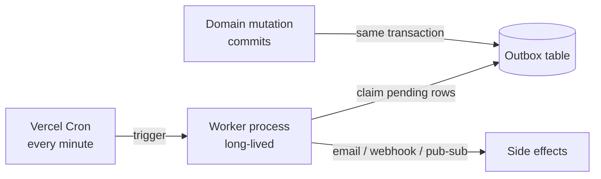

### 7.2 Environment parity

| Concern | Local | Production [TARGET] |
| :--- | :--- | :--- |
| API surface | Express `:4000` and Route Handlers | Route Handlers primary; Express optional |
| Redis | In-memory fallback permitted | **Required**; boot assertion refuses production start without it |
| Queue | In-process `setInterval` | Durable outbox + worker + Cron |
| Bus | In-process `EventEmitter` | Redis pub/sub |
| Storage | Local filesystem fallback | Object storage only; never `data:` URLs in the DB |

---

## 8. Two-runtime adapter contract

### 8.1 The contract

Both runtimes are **thin adapters** over the identical domain layer. They share a
single request-processing pipeline, expressed as a pure function of a request
context to a result. Neither adapter may contain pricing, authorisation policy,
coupon logic or transaction boundaries.

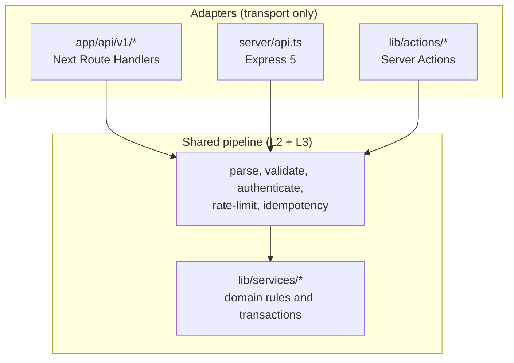

| Contract element | Requirement |
| :--- | :--- |
| **Input** | A transport-neutral request context: method, path params, query, parsed body, headers of interest (`Idempotency-Key`, `Authorization`), and resolved tenant. |
| **Output** | A transport-neutral result: `{ status, body, headers }` where `body` is the shared envelope. |
| **Envelope** | `{ success: true, data }` or `{ success: false, error: { code, message } }` [BUILT] `lib/api/response.ts`. |
| **Error mapping** | One error taxonomy maps to HTTP statuses; no stack traces cross the boundary. |
| **No duplication** | An adapter that reimplements a domain rule is a defect, not a style choice. The B2B order adapter currently violates this (`app/api/v1/orders/route.ts:93-96`). |
| **Ordering of shared stages** | Rate limit → idempotency → Zod parse → auth → service call. Identical in both runtimes. |

### 8.2 How the contract test prevents drift

A **contract test** asserts that, for the same input, the Route Handler and the
Express adapter return **byte-compatible** responses (**same status, same body,
same relevant headers**). It is the mechanism that makes "one codebase, two
runtimes" safe rather than aspirational ([MASTER_PLAN.md §4.2](./MASTER_PLAN.md)).

| Property | Design |
| :--- | :--- |
| Coverage | Every endpoint exposed by both runtimes: menu, order creation, coupon validation, KDS subscription handshake, payment webhook, metrics |
| Fixtures | Deterministic seed data and fixed clock/injected `now`, so time and ids do not cause spurious diffs |
| Comparison | Deep-equal on status and JSON body; header comparison restricted to a documented allowlist (content-type, `Retry-After`, signature headers) |
| Negative cases | Invalid body, missing key, expired session, unknown tenant → **identical** error envelopes and statuses |
| CI gate | The suite fails the build on any divergence [TARGET Phase 5]. |
| Known gap | Express has **no order-creation endpoint at all** today, so there is nothing to compare; this must be closed before the contract can be enforced ([AUDIT.md P0-1](./AUDIT.md)). |

**Why it prevents drift.** Drift is invisible when each runtime is exercised
alone — exactly the current situation. A byte-comparison test forces any new rule
to be implemented once, in the shared layer, or fail CI.

---

## 9. Scaling model

### 9.1 Design targets

| Dimension | Target |
| :--- | :--- |
| Public read traffic (cached) | 5M page views / month; 10k concurrent bursts served by CDN/ISR |
| Storefront TTFB p95 (cached) | < 200 ms |
| Storefront TTFB p95 (uncached) | < 600 ms |
| API read p95 | < 250 ms |
| API write p95 | < 500 ms |
| Peak write throughput | ~200 orders/min/tenant |
| Concurrent KDS screens | 50 per tenant |
| Tenants | 100+ on shared infrastructure |
| Job queue lag p95 | < 60 s |

### 9.2 Scaling levers, in the order they are applied

Apply in sequence; each is cheaper than the next and defers the one after it.

| Order | Lever | Effect | When to reach for it |
| :-- | :--- | :--- | :--- |
| 1 | **Cache harder** — ISR/PPR for public pages, Redis cache-aside for hot API reads, `stale-while-revalidate` at the edge | Removes origin load entirely for repeat reads | First; always |
| 2 | **Statelessness** — eliminate per-instance state so any instance serves any request | Enables horizontal scale and correct scaling for correctness-critical stores | As soon as more than one instance exists |
| 3 | **Offload writes** — commit then enqueue; side effects never block a response | Bounds write latency independent of downstream health | With the outbox |
| 4 | **Connection pooling** — pooler in transaction mode, small per-instance pool | Survives serverless fan-out against `max_connections` | Before adding replicas |
| 5 | **Read replicas** — route reporting, dashboards, sitemap and analytics to the replica | Frees the primary for transactional work | When read load contends with writes |
| 6 | **Shard by tenant** — `tenantId` is the natural shard key | Distributes the write hotspot | Only after replicas and caching are exhausted |
| 7 | **Vertical first** — the biggest Postgres instance beats premature sharding | Lowest complexity per unit of headroom | Prefer over 6 whenever possible |

### 9.3 Statelessness

For any instance to serve any request, four stores must move out of process:
the **cache**, the **rate limiter**, the **idempotency store**, and the
**pub/sub bus**. The **queue** moves to the database as an outbox so it lives
with the data it is atomic with. The only remaining in-process state should be
request-scoped values ([MASTER_PLAN.md §3](./MASTER_PLAN.md), [§12](#12-known-defects-and-remediation-phases)).

### 9.4 Caching tiers

| Tier | Scope | Contents | Invalidation |
| :--- | :--- | :--- | :--- |
| Edge / ISR | CDN | Rendered HTML for public routes | Tag-based revalidation |
| Application cache | Redis | Menu, settings, tenant lookups, hot reads | Versioned key prefixes, not `KEYS` |
| HTTP cache | Browser | Hashed static assets, immutable | Filename hash |
| In-request | Function | De-duplication within a single render | Request boundary |

**Rule:** a cache is never a system of record. If the answer is not recoverable
from Postgres, it must not live only in Redis.

### 9.5 Read replicas and connection pooling

Read replicas take reporting, dashboards, sitemap generation and analytics —
reads that are latency-tolerant and volume-heavy — leaving the primary for the
money path. Pooling is a prerequisite: [BUILT] `lib/db/prisma.ts:8` opens a pool
per instance with no bounds, so serverless fan-out multiplies connections against
a fixed `max_connections`. [TARGET] Explicit `max`, `idleTimeoutMillis`,
`connectionTimeoutMillis` and `statement_timeout`, behind a transaction-mode
pooler ([DATABASE.md](./DATABASE.md)).

### 9.6 Cursor pagination

Offset pagination is banned on large tables (`Order`, `ContactMessage`,
`ActivityLog`, `LoyaltyLedger`, `WaitlistEntry`). Cursor pagination keys on
`(tenantId, createdAt, id)` and requires a supporting composite index
([AUDIT.md P2-3](./AUDIT.md), [DATABASE.md](./DATABASE.md)). This bounds page
cost independent of depth, which offset pagination cannot.

---

## 10. Failure modes and degradation

Reliability is defined by behaviour under failure, not under success. The
governing rule: **a degraded dependency makes the system slower, never wrong.**

| Failure | Required behaviour | Phase |
| :--- | :--- | :--- |
| **Redis unavailable** | Bypass cache (correct, slower); fall back to a **local** rate limit and log loudly. **Never fail an order because the cache is down.** | 3 |
| Payment gateway timeout | Do not mark paid. Keep the order `PENDING`, surface "confirming", reconcile via webhook/poll. Never double-charge on retry. | 4 |
| Webhook duplicate delivery | Idempotency key short-circuits; second delivery returns `200` with no state change. | 3 |
| Job handler permanently failing | Exponential backoff, then dead-letter with the full payload retained and a replay path. | 3 |
| Postgres primary failover | Pooler retries; requests return `503` with `Retry-After`; no partial writes (one transaction per order). | 2/3 |
| Deploy mid-flight | Graceful drain; in-flight requests finish; new instances are stateless so nothing is lost. | 3 |
| Kitchen screen disconnected | SSE reconnect with `Last-Event-ID`; client re-fetches current ticket state to resync. | 3 |
| Traffic spike | Edge rate limit + load shedding with `429`; caches absorb reads. | 4 |
| Unknown tenant | **Fail closed**: `404`. Never serve the default tenant's data. | 2 |
| Build/runtime missing optional package | Fail the upload/build explicitly; never fall through to a `data:` URL in the database. | 1 |

### 10.1 Degradation ladder

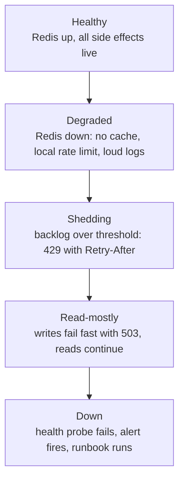

### 10.2 Service level objectives

| SLO | Target |
| :--- | :--- |
| Availability (storefront) | 99.9% monthly |
| Availability (admin API) | 99.5% monthly |
| Error rate (5xx) | < 0.5% of requests |
| Payment webhook success | > 99.5% within 5 minutes |
| Job queue lag p95 | < 60 s |
| Data durability | RPO ≤ 5 min, RTO ≤ 1 h |

Operational procedures, alerting and the restore drill live in
[OPERATIONS.md](./OPERATIONS.md). Backup and disaster recovery: automated daily
full backup + point-in-time recovery, and a **quarterly restore drill** — a
backup that has never been restored is not a backup
([MASTER_PLAN.md §10.3](./MASTER_PLAN.md)).

---

## 11. Cross-cutting concerns

These are rules that must hold everywhere. They are enforced by a shared
mechanism, not by convention.

| Concern | Rule | Mechanism | Status |
| :--- | :--- | :--- | :--- |
| **Configuration over hardcoding** | No magic numbers in components; no duplicated address/phone/hours; one typed module per concern in `config/`. | `config/site.ts`, `limits.ts`, `roles.ts`, `s2s.ts`, `seo.ts`, `navigation.ts` | [BUILT]; [TARGET] JSON-LD in `app/layout.tsx` must read from `config/site.ts` instead of restating it ([AUDIT.md P2-10](./AUDIT.md)) |
| **Validation** | Zod at every trust boundary: body, query, params, headers, webhook payload, form. Parse, never cast. | `lib/validation/schemas.ts`, `contact.ts`, per-route schemas | [BUILT] |
| **Error taxonomy** | One `AppError` taxonomy — validation, auth, not-found, conflict, rate-limit, upstream — mapped to HTTP statuses. Never leak a stack trace. | `lib/api/response.ts` (`ok`, `fail`, `validationError`, `unauthorized`, `forbidden`, `rateLimited`, `serverError`) | [BUILT] |
| **Structured logging** | JSON with `requestId`, `tenantId`, `route`, `durationMs`, `outcome`, `errorCode`. Never log secrets or raw PII. | `lib/logger.ts` | [BUILT]; `tenantId`/`outcome`/`errorCode` are [TARGET] additions |
| **Time** | Store UTC (`timestamptz`); render in the tenant's timezone; all "today"/"open now" logic timezone-explicit and injectable for tests. | `lib/services/hours.ts` | [BUILT] structure; timezone injection is [TARGET] |
| **Money** | `Decimal(10,2)` plus an explicit `currency`. Round half-up once, at the total. Never float arithmetic. | Prisma `Decimal`; pricing in `lib/services/orders.ts` | [BUILT] in the model; [TARGET] the B2B adapter still uses `Number()` and float `reduce` ([AUDIT.md P1-7](./AUDIT.md)) |
| **Cursor pagination** | Cursor-based for order, message, activity and loyalty lists. Offset banned on large tables. | Query shape + composite index | [TARGET] |
| **Feature flags** | A `Setting`-backed flag store so a risky rollout can be disabled without a deploy. | `lib/services/settings.ts` (backing store exists) | [TARGET] for the flag API |
| **Idempotency** | Every retryable mutation accepts an `Idempotency-Key`, bound to the request body hash and scoped per tenant/endpoint. | `lib/resilience/idempotency.ts` | [BUILT] with a store; [TARGET] body-hash binding |
| **IDs** | UUIDv4 for internal keys; human-readable codes for customer references, unique in the database rather than by retry luck. | Prisma defaults + unique constraints | [BUILT] models; [TARGET] tenant-scoped uniqueness (`(tenantId, orderNumber)`) ([AUDIT.md P1-8](./AUDIT.md)) |

---

## 12. Known defects and remediation phases

The four headline defects below are **verified**. Each maps to a delivery phase
(1–9) from [ROADMAP.md](./ROADMAP.md) / [MASTER_PLAN.md §15](./MASTER_PLAN.md).

| # | Defect | Evidence (verified) | Impact | Phase |
| :-- | :--- | :--- | :--- | :--- |
| D1 | **In-process singleton state** — event bus, job queue, cache fallback and rate limiter live in process memory | `lib/realtime/bus.ts:24` `new EventEmitter()`; `lib/queue/job-queue.ts:26` array + `:83` `setInterval`; `lib/rate-limit/limiter.ts:12` `new Map()`; `lib/cache/cache-manager.ts:11` `new Map()`. `lib/cache/cache-manager.ts` and `lib/resilience/idempotency.ts` **have** Upstash paths but silently fall back to memory. | KDS tickets dropped cross-instance; emails/webhooks lost on deploy; rate limits multiply by instance count; cache diverges per instance. Two runtimes today hold **separate** copies. | **3** |
| D2 | **Tenant resolution fails open** — unknown/suspended tenant silently returns the default tenant; tenant filters are `OR: [{ tenantId }, { tenantId: null }]` | `lib/db/tenant.ts:54-67`; `app/api/v1/orders/route.ts:47`; `server/api.ts:164,192` | Cross-tenant data leakage and a performance hazard (the `OR` defeats index seeks). Also write-capable on hot read paths, including every SSE connect. | **2** |
| D3 | **Permissive CORS with credentials** — origin callback returns `true` on both branches | `server/api.ts:29-42` — `callback(null, true)` on each branch with `credentials: true`; `allowedHeaders` omits `Idempotency-Key` | Any origin may make credentialed calls to the standalone API. The allowlist is decorative. | **4** |
| D4 | **Price tampering on the B2B order adapter** — client-supplied `price` summed for the subtotal | `app/api/v1/orders/route.ts:22,93-96`; tax hardcoded 5%, discount hardcoded 0, no idempotency, no inventory check, no loyalty accrual, `orderNumber` from `Date.now()` + 4 random digits against a `@unique` column | Direct revenue loss; fraudulent orders; corrupted analytics and loyalty; poisoned kitchen ticket. | **1** |

### 12.1 Secondary defects folded into the same phases

| Defect | Evidence | Phase |
| :--- | :--- | :--- |
| KDS broadcast publishes a **slug** while subscribers register a **UUID** | `server/api.ts:287` (`order.tenantId \|\| "spice-saffron"`) vs `app/api/v1/realtime/kds/route.ts:40` | 2 |
| ~~`EMAIL_DISPATCH` handler only logs; never calls `lib/email/notifier.ts`~~ **FIXED** (Phase 1) | `lib/queue/handlers.ts` | 1 |
| ~~Uploads fall through to a base64 `data:` URL stored in Postgres~~ **FIXED** (Phase 1) — `lib/storage/` S3-compatible driver | `app/api/upload/route.ts` | 1 |
| `PrismaPg` created with no pool bounds or statement timeout | `lib/db/prisma.ts:8` | 2/3 |
| Idempotency key not bound to the request body, not tenant-scoped | `lib/resilience/idempotency.ts:54` | 3/4 |
| Cache invalidation uses `KEYS` (O(N), blocking) | `lib/cache/cache-manager.ts:138` | 3 |
| Express API surface entirely untested | `tests/**` inventory | 5 |
| LCP image 951 KB; assets 0.95–2.9 MB | `public/images/hero/hero-dining.jpg` et al. | 6 |

### 12.2 Remediation sequencing rationale

Correctness and deployability precede optimisation. Phase 1 makes the system
deployable and stops money loss (D4). Phase 2 makes the data layer safe and fast
(D2), which every later phase depends on. Phase 3 removes the largest correctness
risk (D1). Phase 4 hardens security (D3). Phases 5–9 test, optimise, observe,
restructure and commercialise. Full task breakdown in
[ROADMAP.md](./ROADMAP.md).

---

## 13. Architecture Decision Record index

Architecture Decision Records live in [`./adr/`](./adr/). They are authored
during **Phase 8 (Structure & DX)** per [MASTER_PLAN.md §15](./MASTER_PLAN.md);
the entries below are the decisions this document already encodes, listed here so
their rationale is discoverable before the individual records exist.

| ADR | Title | Decision | Status |
| :--- | :--- | :--- | :--- |
| ADR-0001 | Vercel-native API with Express retained | Next.js `app/api/v1/*` Route Handlers are the primary production API; Express stays for self-hosting, workers and local dev. Both are adapters over `lib/services/*`. | Accepted |
| ADR-0002 | Two-runtime adapter contract | A byte-comparison contract test is the guard against drift between Route Handlers and Express. | Accepted |
| ADR-0003 | Redis as a hard production dependency | Cache, rate limit, idempotency and pub/sub are Redis-backed in production; in-memory implementations are dev/test only, gated by a boot assertion. | Accepted |
| ADR-0004 | Durable DB-backed outbox instead of an in-process timer | Background side effects commit an outbox row with the domain write and are drained by a long-lived worker triggered by Cron. A serverless function cannot host a timer worker. | Accepted |
| ADR-0005 | Fail-closed tenancy | Unknown or suspended tenant returns `404`; `tenantId` becomes `NOT NULL` and reads stop using the `OR tenantId/null` pattern. | Accepted |
| ADR-0006 | Server-side authoritative pricing everywhere | Pricing, coupons, loyalty and inventory are decided only in `lib/services/orders.ts`; no adapter accepts a client price. | Accepted |
| ADR-0007 | Money as `Decimal(10,2)` | No float arithmetic on the money path; a single rounding point at the total. | Accepted |
| ADR-0008 | Redis pub/sub as the realtime backbone | SSE in either runtime subscribes to a shared channel keyed by tenant UUID; the in-process `EventEmitter` is dev-only. | Accepted |
| ADR-0009 | No monorepo, no `src/` move | Keep the idiomatic App Router layout; a later split of `lib/` into `domain/` + `infrastructure/` is a refactor, not a repository change. | Accepted |
| ADR-0010 | Cursor pagination on large tables | Offset pagination is banned on `Order`, `ContactMessage`, `ActivityLog`, `LoyaltyLedger`, `WaitlistEntry`. | Accepted |

New records should follow the standard form — **Context · Decision · Status ·
Consequences** — and link back to the relevant section of this document.

---

## 14. Footer

**Related documents:** [Master Plan](./MASTER_PLAN.md) · [Database](./DATABASE.md) ·
[Audit](./AUDIT.md) · [Roadmap](./ROADMAP.md) · [Operations](./OPERATIONS.md) ·
[Testing](./TESTING.md) · [SEO & Performance](./SEO-AND-PERFORMANCE.md) ·
[ADRs](./adr/) · [Security Policy](../SECURITY.md)

© 2026 Himanshu. All Rights Reserved.

## Durable outbox (Phase 3)

`OutboxEvent` rows are written inside the business transaction (`lib/outbox/enqueue.ts`) and drained by `processOutbox` (`FOR UPDATE SKIP LOCKED` claim with a 2 min lease, exponential backoff, DEAD after 6 attempts) from `/api/cron/outbox` and a post-response `after()` hook. Handlers (`lib/outbox/handlers.ts`) are independent of `lib/queue/handlers` and must be idempotent (at-least-once).
