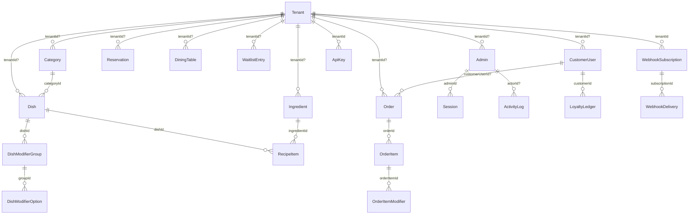
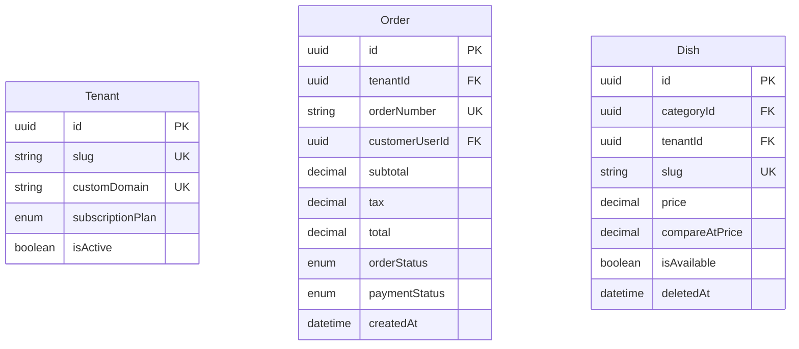

# Database Engineering

**Project:** Spice & Saffron — Indian Fine Dining & Café Platform
**Owner:** Himanshu ([@Himanshusingh204](https://github.com/Himanshusingh204))
**Document status:** Living reference — updated whenever the schema, indexes, or `lib/db/*` change
**Last updated:** 2026-10-15
**Engine:** PostgreSQL 18 · Prisma 7.9.1 (`@prisma/adapter-pg`) · Vercel serverless + optional standalone worker

> This document is the contract for the data layer. Every claim about the
> current schema below was read from `prisma/schema.prisma` (26 models, 14 enums,
> 67 `@@index`/`@@unique` entries) at the date above. Anything not verified is
> labelled a recommendation. Changes ship as reviewed migrations with a rollback
> plan and `EXPLAIN` evidence — see [§10](#10-performance-verification-workflow).

---

## Table of contents

1. [Data model overview](#1-data-model-overview)
2. [Money & precision policy](#2-money--precision-policy)
3. [Indexing strategy](#3-indexing-strategy)
4. [Required composite & partial indexes](#4-required-composite--partial-indexes)
5. [Tenant isolation & the nullable `tenantId` defect](#5-tenant-isolation--the-nullable-tenantid-defect)
6. [Zero-downtime migration plan](#6-zero-downtime-migration-plan)
7. [Connection pooling & the DB handler](#7-connection-pooling--the-db-handler)
8. [Read/write splitting](#8-readwrite-splitting)
9. [Soft delete & data retention](#9-soft-delete--data-retention)
10. [Performance verification workflow](#10-performance-verification-workflow)
11. [Backup, PITR & restore drill](#11-backup-pitr--restore-drill)
12. [Appendix — enums & ID conventions](#12-appendix--enums--id-conventions)

**Companion documents:** [`MASTER_PLAN.md`](./MASTER_PLAN.md) §9 (data layer) and
§17 (definition of done) · [`AUDIT.md`](./AUDIT.md) (P0/P1 findings) ·
[`ROADMAP.md`](./ROADMAP.md) (phase sequencing) · [`ARCHITECTURE.md`](./ARCHITECTURE.md)
(runtime topology). Where those documents and this one disagree on a *fact*,
this document reflects the verified schema.

---

## 1. Data model overview

### 1.1 Core entity relationships





**Closed 2026-10-23 (AUDIT P2-4):** `GalleryImage`, `ContactMessage`, `Review`, `Setting` and `Coupon` now
carry `tenantId` (NOT NULL, FK `ON DELETE RESTRICT`, indexed), as do `Category` and `Dish`.
`Tenant.plan` (`FREE`/`STARTER`/`PRO`, default `STARTER`) is the quota tier. See
[§5](#5-tenant-isolation--the-nullable-tenantid-defect).

### 1.2 Models by bounded context

The verified schema defines **26 models**. Any figure of "24" is stale: it
predates the in-flight migration
`20260905180000_add_stations_inventory_tables_loyalty`, which added `DiningTable`,
`WaitlistEntry`, `Ingredient`, `RecipeItem`, `CustomerUser` and `LoyaltyLedger`.
This count was verified directly against `prisma/schema.prisma` on 2026-10-15.

| Context | Models | Notes |
| :--- | :--- | :--- |
| **Identity** | `Admin`, `Session` | Argon2id password hash; sessions stored as SHA-256 `tokenHash`. |
| **Tenancy** | `Tenant` | Root of isolation; `slug`/`customDomain` unique. |
| **Catalog** | `Category`, `Dish`, `DishModifierGroup`, `DishModifierOption` | Menu. `Category`/`Dish` soft-delete via `deletedAt`. |
| **Ordering** | `Order`, `OrderItem`, `OrderItemModifier`, `Coupon` | Money-bearing. `OrderItem.dishName` denormalised. |
| **Dining room** | `DiningTable`, `WaitlistEntry`, `Reservation` | Floor plan, queue, bookings. |
| **Kitchen** | *(no dedicated table)* | Modelled as `Dish.station` + `OrderItem.station` (`"HOT_KITCHEN"` default) and `OrderItem.isCompleted` — the KDS ticket state. A first-class `Station`/`KitchenTicket` table is a future option, not present today. |
| **Inventory** | `Ingredient`, `RecipeItem` | Stock + BOM join (`@@unique([dishId, ingredientId])`). |
| **Loyalty** | `CustomerUser`, `LoyaltyLedger` | Append-only points ledger; `Order` links back via `customerUserId`/`orderId`. |
| **Content** | `GalleryImage`, `Review` | Public-facing, **no `tenantId`**. |
| **Messaging** | `ContactMessage` | Inbound contact form, **no `tenantId`**; `ipHash` for abuse control. |
| **Integration** | `ApiKey`, `WebhookSubscription`, `WebhookDelivery` | S2S auth + outbound delivery log. |
| **Operations** | `ActivityLog`, `Setting` | Audit trail (actor-attributed) and global key/value settings. |

### 1.3 Relationship and integrity observations

- **UUIDv4 primary keys** everywhere (`@db.Uuid`), generated in the application by
  Prisma. Fine for isolation; random UUIDv4 has poor index locality on the primary
  key compared with monotonic keys. At this scale it is not yet a problem, but it
  is the reason `createdAt`-ordered list indexes ([§4](#4-required-composite--partial-indexes))
  matter rather than relying on PK order.
- **Cascade policy is inconsistent and worth a review:** `Dish.category` uses
  `onDelete: Restrict` (good — a category cannot silently orphan its dishes),
  while `Category`/`Dish`/`Order`/`Reservation`/`Admin` tenant relations use
  `onDelete: SetNull`/`Cascade` on a **nullable** `tenantId`. Cascade-on-delete of
  a `Tenant` would destroy orders; `SetNull` silently strands rows in the
  "global/shared" bucket that the `OR tenantId IS NULL` reads then expose to every
  tenant. Neither behaviour is intentional; see [§5.7](#57-target-design).
- **`Order.tableNumber` is a free-text `String?`**, not a foreign key to
  `DiningTable.id`. Floor-plan assignment and order seating cannot be joined.
- **`DiningTable.tableNumber` is not unique** (even per tenant), so the floor plan
  can contain two tables numbered `12`.
- **`Setting.key` is globally unique** and `Coupon.code` is globally unique, so two
  tenants cannot both define `"gst_number"` or `"DIWALI20"`. See [§5.4](#54-globally-unique-keys-that-block-multi-tenancy).

---

## 2. Money & precision policy

### 2.1 The rules

| Rule | Detail |
| :--- | :--- |
| **Storage type** | `Decimal(10,2)` for every monetary column — `Dish.price`, `Dish.compareAtPrice`, `Order.subtotal/tax/discount/total/tip`, `OrderItem.price`, `OrderItemModifier.priceDelta`, `DishModifierOption.priceDelta`, `Coupon.minOrder`, `Ingredient.costPerUnit`, `CustomerUser.lifetimeSpend`. |
| **Range** | `NUMERIC(10,2)` = ±99,999,999.99. Sufficient for a single café; **not** for `lifetimeSpend` of a high-volume chain tenant — widen to `Decimal(14,2)` before multi-tenant launch. |
| **Currency** | INR (`₹`), single currency. Tax is GST. There is **no currency column**, so a multi-currency tenant cannot be represented today. |
| **Float ban** | JavaScript `number` is IEEE-754 binary64. `0.1 + 0.2 !== 0.3`, `19.99 * 3 === 59.97000000000001`. Any monetary value that touches a JS `number` and is then persisted or displayed is a correctness bug. |
| **In-app arithmetic** | Do it with `Prisma.Decimal` (re-exported `decimal.js`), integer paise, or a `Decimal` library — never `number` `reduce`/`+`/`*`. |
| **Rounding** | Round **half-up (ties away from zero)** to 2 dp, in one place (a `lib/money.ts` module), at the boundary where a value becomes storable. Never round twice. Tax is computed on the **taxable base** (post-discount) and rounded once per order; line-level display values are derived, not re-summed. |
| **Serialisation** | The wire format for money is a **string with 2 dp** (`"249.00"`), or integer paise (`24900`). Never a bare JSON float. |

### 2.2 The concrete defects (verified in the working tree)

**Defect A — precision loss at the menu serialisation boundary**
`server/api.ts:118` (inside `GET /api/v1/menu`):

```ts
dishes: c.dishes.map((d) => ({
  ...
  price: Number(d.price),   // ← Prisma.Decimal → binary float, irreversibly
  ...
}))
```

`d.price` is a `Prisma.Decimal`. `Number(...)` converts `249.99` into the nearest
binary64 value; re-serialised it may render `249.99` (usually) but any downstream
`+`/`*` accumulates error, and the cast is lossy by construction. The fix is to
emit `d.price.toString()` (or `.toFixed(2)`).

**Defect B — float money math on order totals**
`app/api/v1/orders/route.ts:93`:

```ts
const subtotal = data.items.reduce((sum, item) => sum + item.price * item.quantity, 0);
const tax      = Math.round(subtotal * 0.05 * 100) / 100;   // 5% GST, float
const total    = subtotal + tax - discount;
```

`item.price` is a client-supplied `number` (`route.ts:22`), summed in binary
floating point, then written into `Decimal(10,2)` columns. Two independent bugs
compound here:

1. **Precision:** binary64 addition over a cart is not exact; the rounded total
   can differ by a paisa from the true total, and the stored `subtotal + tax`
   need not equal the stored `total`.
2. **Trust:** the price is never re-read from `db.dish.price`. This is the
   live money-loss vulnerability recorded as **P0-1** in [`AUDIT.md`](./AUDIT.md).
   Precision is moot if the client sets the price.

The same route also emits `Number(order.total)` at `route.ts:140` and `:153`
(the KDS broadcast and the outbound webhook) — money leaving the system as a float.

### 2.3 Remediation

```ts
// lib/money.ts  (new — single source of rounding truth)
import { Prisma } from "@/lib/generated/prisma/client";

export type Money = Prisma.Decimal;

export const toMoney = (v: Prisma.Decimal | string | number): Money =>
  new Prisma.Decimal(v);

/** Banker's-free, deterministic half-up to 2 dp. */
export const round2 = (v: Money): Money => v.toDecimalPlaces(2, Prisma.Decimal.ROUND_HALF_UP);

/** Serialise to the wire as a 2-dp string. */
export const toWire = (v: Money): string => v.toFixed(2);

/**
 * Server-authoritative pricing: never trust client prices.
 * Re-reads each dish, validates availability + soft-delete, sums in Decimal.
 */
export function priceCart(
  lines: { dishId: string; quantity: number }[],
  dishes: { id: string; price: Prisma.Decimal; isAvailable: boolean }[],
  taxRate = "0.05",
): { subtotal: Money; tax: Money; total: Money } {
  const byId = new Map(dishes.map((d) => [d.id, d]));
  const subtotal = lines.reduce((sum, l) => {
    const dish = byId.get(l.dishId);
    if (!dish || !dish.isAvailable) throw new Error(`DISH_UNAVAILABLE:${l.dishId}`);
    return sum.plus(dish.price.times(l.quantity));
  }, new Prisma.Decimal(0));
  const tax = round2(subtotal.times(taxRate));
  return { subtotal: round2(subtotal), tax, total: round2(subtotal.plus(tax)) };
}
```

**Gates for merging a money change:** unit test with a cart that sums to a value
whose exact decimal representation is not binary-representable (e.g.
`19.99 × 3 + 4.05`), asserting the stored `total` equals the decimal recomputation
and that `subtotal + tax − discount === total`. See [`MASTER_PLAN.md`](./MASTER_PLAN.md) §9 and §17.

---

## 3. Indexing strategy

### 3.1 Principles

1. **Index for the query, not for the column.** An index exists to serve a named
   query shape; if no query needs it, it is a write tax and gets dropped.
2. **Equality columns first, then range, then sort.** `(categoryId, isAvailable,
   deletedAt, sortOrder)` — Postgres can seek on the equality predicates and read
   the sort from the index with no in-memory sort.
3. **One composite beats several single-column indexes** — a leftmost prefix of a
   composite satisfies lookups that a single-column index would.
4. **Partial indexes for soft deletes.** `WHERE "deletedAt" IS NULL` keeps the hot
   index small and always-hit; soft-deleted rows live outside it.
5. **Every index names the query it serves**, in the migration and in this doc, so
   dead indexes are findable by reading the schema.
6. **Indexes cost write throughput.** Every `INSERT`/`UPDATE`/`DELETE` maintains
   each index. Prefer two well-chosen composites over eight singles.
7. **Never index `metadata Json` or free text** (e.g. `ContactMessage.message`,
   `Review.comment`). Use `pg_trgm` only with a measured need and a GIN index.

### 3.2 Findings — redundant indexes to DROP

Each row is a single-column index that duplicates a `@unique` constraint that
already created an identical B-tree. Dropping them is pure write-throughput
recovery with **zero** read cost. Exact Prisma lines:

| Model | DROP this | Already covered by | Why it is redundant |
| :--- | :--- | :--- | :--- |
| `Tenant` | `@@index([slug])` | `slug String @unique` | Same column, same B-tree. |
| `Tenant` | `@@index([customDomain])` | `customDomain String? @unique` | Duplicate. |
| `Admin` | `@@index([email])` | `email String @unique` | Duplicate. |
| `Dish` | `@@index([slug])` | `slug String @unique` | Duplicate. |
| `Reservation` | `@@index([referenceCode])` | `referenceCode String @unique` | Duplicate. |
| `Coupon` | `@@index([code])` | `code String @unique` | Duplicate. |
| `ApiKey` | `@@index([keyHash])` | `keyHash String @unique` | Duplicate (and it is the hot auth path — the unique index is used). |
| `CustomerUser` | `@@index([email])` | `email String @unique` | Duplicate. |
| `RecipeItem` | `@@index([dishId])` | `@@unique([dishId, ingredientId])` | `dishId` is the unique's leftmost prefix. |

> `MASTER_PLAN.md` §9.3 also lists `Category @@index([slug])` as redundant. There
> is **no** such index in the schema — `Category`'s indexes are only `sortOrder`,
> `isActive`, `tenantId`. Do not "drop" a line that does not exist.

### 3.3 Findings — indexes superseded once composites are added

These are not duplicates of a unique; they become redundant *after* the composite
indexes in [§4](#4-required-composite--partial-indexes) land, because they are
covered by a leftmost prefix. Drop them in the same migration that adds the composite.

| Model | Superseded index | Covered by composite |
| :--- | :--- | :--- |
| `Dish` | `@@index([categoryId])` | `(categoryId, isAvailable, deletedAt, sortOrder)` |
| `Order` | `@@index([tenantId])` | `(tenantId, orderStatus, createdAt)` |
| `Reservation` | `@@index([tenantId])` | `(tenantId, date, status)` |
| `WaitlistEntry` | `@@index([tenantId])` | `(tenantId, status, createdAt)` |
| `LoyaltyLedger` | `@@index([customerId])` | `(customerId, createdAt)` |
| `WebhookDelivery` | `@@index([subscriptionId])` | `(subscriptionId, createdAt)` |
| `DishModifierGroup` | `@@index([dishId])` | `(dishId, sortOrder)` |
| `DishModifierOption` | `@@index([groupId])` | `(groupId, sortOrder)` |

Kept deliberately, still useful standalone: `Session.@@index([expiresAt])` (TTL
sweep), `Order.@@index([gatewayOrderId])` (webhook reconciliation), `Order.@@index([customerUserId])`,
`Ingredient.@@index([name])`, `DiningTable.@@index([status])`, `ApiKey.@@index([tenantId])`.

---

## 4. Required composite & partial indexes

Each block names the verified query it serves. Apply these via a reviewed migration
(see [§6](#6-zero-downtime-migration-plan)).

### 4.1 Menu load — the 195 ms query

**Query (verified `server/api.ts:97-106`, `Dish.findMany` measured at `195 ms` in `build.log:18-19`):**
`Category WHERE isActive = true AND deletedAt IS NULL ORDER BY sortOrder`
with `Dish WHERE categoryId = ? AND isAvailable = true AND deletedAt IS NULL ORDER BY sortOrder`.

```prisma
// Category: serves the active-menu category list
@@index([isActive, deletedAt, sortOrder])

// Dish: serves the nested per-category dish list. Equality (categoryId,
// isAvailable) → range/is-null (deletedAt) → sort (sortOrder).
@@index([categoryId, isAvailable, deletedAt, sortOrder])
```

The only pre-existing index on this path is `Dish.@@index([categoryId])`, which
forces Postgres to filter `isAvailable`/`deletedAt` and sort `sortOrder` in memory —
the cause of the 195 ms. `Category` has no index that includes `sortOrder` with
`isActive`/`deletedAt`, so the outer query also sorts in memory.

### 4.2 Order lists — B2B, admin, KDS

**Query (verified `server/api.ts:162-172` and `app/api/v1/orders/route.ts:45-55`):**
`WHERE (tenantId = ? OR tenantId IS NULL) AND orderStatus = ? ORDER BY createdAt DESC LIMIT ?`.

```prisma
// Order: tenant-scoped, status-filtered, newest-first list
@@index([tenantId, orderStatus, createdAt])

// Order: tenant-scoped, newest-first list (no status filter)
@@index([tenantId, createdAt])

// Order: "my orders" by email (customer order history / support lookup)
@@index([customerEmail])
```

> Until [§5](#5-tenant-isolation--the-nullable-tenantid-defect) removes the
> `OR tenantId IS NULL` branch, Postgres cannot do a single range seek on
> `(tenantId, orderStatus, createdAt)`; it will `BitmapOr` the two branches and
> then sort. The composite is still required — it is the target-state index — but
> the plan will only become a clean index-only range scan **after** `tenantId` is
> `NOT NULL` and the `OR` is deleted.

### 4.3 Reservation availability

**Query:** `WHERE tenantId = ? AND date = ? AND status = ?`.

```prisma
// Reservation: availability lookups for a given service date
@@index([tenantId, date, status])
```

### 4.4 Waitlist board

**Query (verified pattern):** `WHERE tenantId = ? AND status = ? ORDER BY createdAt`.

```prisma
// WaitlistEntry: the live queue board, oldest-first within a status
@@index([tenantId, status, createdAt])
```

### 4.5 Loyalty ledger

**Query:** `WHERE customerId = ? ORDER BY createdAt DESC` (statement view).

```prisma
// LoyaltyLedger: a customer's statement, newest-first
@@index([customerId, createdAt])
```

### 4.6 Operations lists

```prisma
// ContactMessage: admin inbox, newest-first within a status
@@index([status, createdAt])

// ActivityLog: per-actor newest-first audit view (createdAt exists already)
@@index([actorId, createdAt])

// WebhookDelivery: deliveries for one subscription, newest-first
@@index([subscriptionId, createdAt])

// DiningTable: duplicate-number detection + floor-plan lookups per tenant
@@index([tenantId, tableNumber])
@@index([tenantId, status])

// Modifier reads (already correct in intent — pair with the composite form)
@@index([dishId, sortOrder])   // DishModifierGroup
@@index([groupId, sortOrder])  // DishModifierOption
```

### 4.7 Partial indexes for soft deletes (hand-edited migration SQL)

Prisma 7 **cannot express a partial index** (`WHERE …`) or `CONCURRENTLY` in the
declarative schema. `@@index` always creates a full index, and `@@index(…, where: …)`
does not exist for PostgreSQL. Therefore these are added as raw SQL in a
hand-edited migration file and **Prisma will not model them** — `prisma migrate diff`
will not report them as drift in either direction, and `prisma migrate dev` will
not try to drop them. That silence is exactly why they need an explicit "drift register".

```sql
-- Serves the hot menu read only; soft-deleted dishes live outside the index.
CREATE INDEX CONCURRENTLY IF NOT EXISTS "Dish_active_menu_idx"
  ON "Dish" ("categoryId", "isAvailable", "sortOrder")
  WHERE "deletedAt" IS NULL;

CREATE INDEX CONCURRENTLY IF NOT EXISTS "Category_active_idx"
  ON "Category" ("isActive", "sortOrder")
  WHERE "deletedAt" IS NULL;
```

If the partial index is added, the composite in [§4.1](#41-menu-load--the-195-ms-query)
can drop `deletedAt` from the key (it is a predicate, not a key column). Pick one
strategy per table; do not ship both, or you pay double write cost.

**Keeping the drift visible (required):**

1. Store every raw index in a versioned directory, `prisma/indexes/*.sql`, with a
   header naming the query it serves. The migration that ships it is a thin wrapper.
2. Add a drift test (`tests/db/index-drift.test.ts`) with one expected list per
   table, `SELECT indexname, indexdef FROM pg_indexes WHERE schemaname = 'public'`,
   and assert the set of expected index names is present and no unexpected
   `_idx` remains. This turns "silent drift" into a red build.
3. Re-run [§10](#10-performance-verification-workflow)'s `EXPLAIN` capture whenever
   any of these predicates change.

---

## 5. Tenant isolation & the nullable `tenantId` defect

This is the central schema defect. It is simultaneously a **correctness/isolation**
hazard and a **performance** hazard, and it is recorded as P0/P1 in
[`AUDIT.md`](./AUDIT.md) and [`MASTER_PLAN.md`](./MASTER_PLAN.md) §9.

### 5.1 The `OR` read pattern

Every tenant-scoped read uses a two-branch predicate. Verified at
`server/api.ts:164`, `server/api.ts:192`, and `app/api/v1/orders/route.ts:47`:

```ts
where: {
  OR: [{ tenantId }, { tenantId: null }],
  ...
}
```

Two problems:

- **Index cost.** An `OR` over the same column compiles to a `BitmapOr` of two
  index scans, or a sequential scan; it can never be the single ordered range seek
  that `(tenantId, orderStatus, createdAt)` was designed to provide. This is why
  the composite indexes in [§4.2](#42-order-lists--b2b-admin-kds) cannot yet be
  fully exploited.
- **Isolation.** Rows with `tenantId IS NULL` are visible to **every** tenant.
  Any record created before the backfill — or by a code path that forgot to set
  `tenantId` — is readable by all tenants.

### 5.2 Tenant resolution fails OPEN

`lib/db/tenant.ts:54-67`:

```ts
export async function resolveTenant(slug?: string | null): Promise<TenantContext> {
  if (!slug || slug === DEFAULT_TENANT_SLUG) {
    return getOrCreateDefaultTenant();
  }
  const tenant = await db.tenant.findUnique({ where: { slug } });
  if (!tenant || !tenant.isActive) {
    return getOrCreateDefaultTenant();   // ← unknown/inactive tenant → flagship tenant
  }
  return tenant;
}
```

A request for a non-existent or deactivated tenant silently receives the **default
flagship tenant's** data instead of a `404`. For a multi-tenant platform that is a
tenancy-confusion bug: `tenantId` is attacker-influenced (via slug/host) and the
failure mode is "serve someone else's data", not "deny". The fix is fail-closed:
an unresolvable or inactive tenant returns `404 Not Found` (or `403`), never the
default tenant.

`getOrCreateDefaultTenant()` (`tenant.ts:17-49`) also performs a **write on a read
path** — a `create` plus up to **five** `updateMany` backfills (`Category`, `Dish`,
`Order`, `Reservation`, `Admin`, `tenant.ts:38-42`) — and it is invoked from the
SSE connect path (`server/api.ts:218`) and from `resolveTenant`. That work should
be a one-time data migration, not a per-connection side effect.

### 5.3 Contexts with no `tenantId` at all

> **Resolved 2026-10-23** by migration `20261023090000_tenant_scope_remaining`. The table below is the
> pre-fix state, kept for the record. Uniqueness is now per tenant (`20261023100000_per_tenant_uniques`):
> `Category(tenantId, slug)`, `Dish(tenantId, slug)`, `Coupon(tenantId, code)`, `Setting(tenantId, key)`.
> `Admin.email`, `CustomerUser.email` and `Order.orderNumber` remain global on purpose.

These tables have **no tenant column** and therefore cannot be isolated by row:

| Model | Consequence |
| :--- | :--- |
| `GalleryImage` | Tenant A's gallery is visible to Tenant B. |
| `ContactMessage` | One tenant's inbound leads are another's. PII cross-leak. |
| `Review` | Reviews are shared across tenants by construction. |
| `Setting` | Global settings, globally unique `key`. |
| `Coupon` | Promo codes are global, globally unique `code`. |

### 5.4 Globally unique keys that block multi-tenancy

A `@unique` on a business key means **one row in the whole database** can hold that
value. Two tenants cannot both have a `"paneer-tikka"` dish slug, the same coupon
code, or the same setting key, and two people with the same email cannot both be
customers at different tenants.

| Model | Globally-unique column | Blocks |
| :--- | :--- | :--- |
| `Dish` | `slug` | Same dish slug in two tenants' menus. |
| `Category` | `slug` | Same category slug in two tenants. |
| `Coupon` | `code` | Two tenants cannot both run `WELCOME10`. |
| `Setting` | `key` | Two tenants cannot both define `gst_number`. |
| `Admin` | `email` | Same person cannot administer two tenants (possibly a feature — decide). |
| `CustomerUser` | `email` | A customer who visits two tenants is forced into one row/one tenant. |
| `Order` | `orderNumber` | Order numbers cannot restart per tenant; sequence is global. |

### 5.5 Replacing global uniques with tenant-scoped keys

The remedy for the table in [§5.4](#54-globally-unique-keys-that-block-multi-tenancy)
is to replace each global `@unique` with a tenant-scoped composite, e.g.:

```prisma
// from:  slug String @unique
// to:
tenantId String  @db.Uuid
slug     String
@@unique([tenantId, slug])

// CustomerUser: a person exists per tenant
@@unique([tenantId, email])

// Order: human-readable sequence scoped to the tenant
@@unique([tenantId, orderNumber])
```

> **PostgreSQL NULL semantics:** with a *nullable* `tenantId`, `@@unique([tenantId,
> slug])` does **not** enforce uniqueness for rows where `tenantId IS NULL` —
> Postgres treats `NULL` values as distinct. PostgreSQL 15+ offers
> `UNIQUE NULLS NOT DISTINCT`, but the correct fix is to remove the nullability,
> not to rely on it. This is another reason [§6](#6-zero-downtime-migration-plan)
> ends with `tenantId NOT NULL`.

### 5.6 Other isolation gaps

- **`ApiKey.keyHash` is globally unique** — fine (hashes are globally distinct),
  but `ApiKey` is the one table where `tenantId` is already `NOT NULL` and the
  design is correct. Use it as the template.
- **`Order.paymentMethod` / `Order.gateway*`** are captured but no `Payment` table
  exists; reconciliation is by loosely-typed string columns.
- **`DiningTable.currentOrderId` is a bare `uuid?`** with no foreign key — it can
  point at a deleted or foreign-tenant order.

### 5.7 Target design

The end state, in order of execution (see [§6](#6-zero-downtime-migration-plan)):

**1. Backfill.** Assign every `tenantId IS NULL` row to the correct tenant. For the
single-tenant deployment this is the flagship tenant; for real multi-tenancy the
mapping must be derived from the owning record (e.g. `Dish.tenantId ←
Category.tenantId`), never defaulted blindly.

**2. `NOT NULL`.** After backfill, `ALTER TABLE … ALTER COLUMN "tenantId" SET
NOT NULL` (fast when preceded by a validated `CHECK`, see §6).

**3. Composite unique keys scoped by tenant** — replace global uniques as in [§5.5](#55-replacing-global-uniques-with-tenant-scoped-keys).

**4. Fail-closed resolution** — `resolveTenant` returns `null` for unknown/inactive
slugs; callers respond `404`. The default-tenant fallback move is deleted.

**5. Delete the `OR` predicate.** Once `tenantId` is `NOT NULL`, every read is
`where: { tenantId }`.

**6. Row Level Security (RLS) as defence in depth.** Application-level filtering is
necessary but not sufficient — one forgotten `where` clause is a cross-tenant leak.
RLS makes the database refuse to return other tenants' rows even then.

```sql
-- Run once, as the table owner, in a migration.
ALTER TABLE "Order"          ENABLE ROW LEVEL SECURITY;
ALTER TABLE "Order"          FORCE  ROW LEVEL SECURITY;   -- owner is NOT exempt
ALTER TABLE "OrderItem"      ENABLE ROW LEVEL SECURITY;
ALTER TABLE "Reservation"    ENABLE ROW LEVEL SECURITY;
ALTER TABLE "WaitlistEntry"  ENABLE ROW LEVEL SECURITY;
ALTER TABLE "DiningTable"    ENABLE ROW LEVEL SECURITY;
ALTER TABLE "CustomerUser"   ENABLE ROW LEVEL SECURITY;
ALTER TABLE "LoyaltyLedger"  ENABLE ROW LEVEL SECURITY;
-- …and every other table that gains tenantId.

-- Fail-closed policy: if app.tenant_id is unset, the setting is NULL,
-- so `tenantId = NULL` is NULL (not TRUE) → zero rows. It never leaks.
CREATE POLICY tenant_isolation ON "Order"
  USING ("tenantId" = current_setting('app.tenant_id', true)::uuid)
  WITH CHECK ("tenantId" = current_setting('app.tenant_id', true)::uuid);
```

**Critical operational detail:** RLS is bypassed by the table **owner** (and any
role with `BYPASSRLS`) unless `FORCE ROW LEVEL SECURITY` is set. The Next.js app
must connect as a **dedicated, non-owner application role** (`sp_app`) with no
`BYPASSRLS`, or all policies are decorative. Migrations run as the owner role;
runtime runs as `sp_app`.

**Setting the tenant per transaction.** Every request runs inside a transaction
that sets `app.tenant_id` first. `SET LOCAL` (via `set_config(..., true)`) is scoped
to the transaction, which is exactly right under PgBouncer transaction pooling
([§7](#7-connection-pooling--the-db-handler)): one transaction = one server
connection, and the setting cannot leak to the next borrower.

```ts
// lib/db/tenant-scope.ts (new)
import { db } from "@/lib/db/prisma";
import type { Prisma } from "@/lib/generated/prisma/client";

/**
 * Run `fn` inside a transaction whose `app.tenant_id` is fixed.
 * Fail-closed: the RLS policies and the explicit `where: { tenantId }`
 * in `fn` both scope every statement.
 */
export async function withTenantScope<T>(
  tenantId: string,
  fn: (tx: Prisma.TransactionClient) => Promise<T>,
): Promise<T> {
  return db.$transaction(async (tx) => {
    // `true` → SET LOCAL semantics; reset at COMMIT/ROLLBACK.
    await tx.$executeRaw`SELECT set_config('app.tenant_id', ${tenantId}, true)`;
    return fn(tx);
  });
}
```

> Tables with **no** `tenantId` ([§5.3](#53-contexts-with-no-tenantid-at-all)) cannot
> be protected this way. They must first gain a `tenantId` column; until then, do
> not treat RLS as complete.

---

## 6. Zero-downtime migration plan

Making `tenantId` `NOT NULL` (and adding the indexes in [§4](#4-required-composite--partial-indexes))
touches every row. On a live table, `ALTER TABLE … SET NOT NULL` takes an
`ACCESS EXCLUSIVE` lock and scans the table. The safe pattern is
**expand → backfill → constrain → contract**, with locks bounded by `lock_timeout`.

### 6.1 Global session guards

Every migration file begins by refusing to take unbounded locks:

```sql
-- Fail fast rather than queue behind a long query and block the whole table.
SET lock_timeout = '3s';
SET statement_timeout = '30s';   -- raise only for the backfill, per statement
```

`lock_timeout` is the single most important guard: an `ACCESS EXCLUSIVE` request
that waits behind a slow `SELECT` blocks **every** subsequent query on that table.
Failing after 3 s and retrying is always better than queueing.

### 6.2 The sequence (per table — `Order` shown)

**Step 0 — expand the schema (additive only, no locks beyond a brief catalog write).**

```sql
-- A CHECK that is NOT yet enforced over existing rows. Cheap: catalog-only.
ALTER TABLE "Order"
  ADD CONSTRAINT "Order_tenantId_not_null_chk"
  CHECK ("tenantId" IS NOT NULL) NOT VALID;
```

**Step 1 — backfill in batches** (never one long `UPDATE`; each batch is its own
transaction so replication and autovacuum keep up):

```sql
-- Repeat until 0 rows affected. `ctid` batching keeps each txn short.
WITH batch AS (
  SELECT ctid FROM "Order" WHERE "tenantId" IS NULL LIMIT 5000
)
UPDATE "Order" o
   SET "tenantId" = '00000000-0000-0000-0000-000000000000'
  FROM batch b
 WHERE o.ctid = b.ctid;
```

Backfill source must be derived, not hard-coded: `Dish.tenantId ←
Category.tenantId`; `Order`/`Reservation`/`WaitlistEntry`/`DiningTable`/`Ingredient`/
`CustomerUser` ← the tenant that owned the write path. Rows that cannot be
attributed are quarantined (`tenantId = <legacy tenant>`) and reviewed, not defaulted
to the flagship tenant.

**Step 2 — validate the constraint** (scans the table but takes only a
`SHARE UPDATE EXCLUSIVE` lock — concurrent reads **and** writes proceed):

```sql
ALTER TABLE "Order" VALIDATE CONSTRAINT "Order_tenantId_not_null_chk";
```

**Step 3 — `SET NOT NULL`** (PostgreSQL 12+, and this is PG 18, reuses the validated
`CHECK` and **skips the full table scan**, so the `ACCESS EXCLUSIVE` lock is
milliseconds):

```sql
ALTER TABLE "Order" ALTER COLUMN "tenantId" SET NOT NULL;
ALTER TABLE "Order" DROP CONSTRAINT "Order_tenantId_not_null_chk";
```

**Step 4 — add the supporting indexes `CONCURRENTLY`** (see §6.3).

**Step 5 — contract** (only after the application no longer references the old
shape): drop the global `@unique` on `slug`/`code`/`orderNumber` and replace with
`@@unique([tenantId, …])`. Swap the unique in one migration
(`DROP INDEX` + `CREATE UNIQUE INDEX CONCURRENTLY`), never both in a dependency order
that leaves a window with **no** uniqueness guarantee longer than necessary —
create the new unique first, then drop the old.

### 6.3 `CREATE INDEX CONCURRENTLY` outside a transaction

`CREATE INDEX CONCURRENTLY` **cannot run inside a transaction block** — this is a
PostgreSQL rule, not a Prisma quirk. Prisma Migrate wraps each `migration.sql` in a
single transaction on PostgreSQL (there is no per-migration "disable transaction"
flag in `prisma migrate dev` — confirmed against the installed Prisma 7 CLI),
so a `CONCURRENTLY` statement placed in a normal migration file will fail.

The supported procedure:

```sql
-- prisma/indexes/2026xxxx_order_list_indexes.sql  (versioned raw SQL)
SET lock_timeout = '3s';
CREATE INDEX CONCURRENTLY IF NOT EXISTS "Order_tenantId_orderStatus_createdAt_idx"
  ON "Order" ("tenantId", "orderStatus", "createdAt");
CREATE INDEX CONCURRENTLY IF NOT EXISTS "Order_tenantId_createdAt_idx"
  ON "Order" ("tenantId", "createdAt");
```

```bash
# 1. Generate an empty migration shell so the change is recorded.
npx prisma migrate dev --create-only --name order_list_indexes
# 2. Replace the generated SQL with the file above's contents, then apply it
#    OUTSIDE the migration transaction (psql, or `prisma db execute`, which does
#    not add its own transaction):
psql "$DATABASE_URL" -f prisma/indexes/2026xxxx_order_list_indexes.sql
# 3. Record the migration as already applied so Prisma does not replay it:
npx prisma migrate resolve --applied 2026xxxx_order_list_indexes
```

> `CREATE INDEX CONCURRENTLY` can leave an **invalid** index if it fails midway
> (`pg_index.indisvalid = false`). Check and clean up:
> `SELECT indexrelid::regclass FROM pg_index WHERE NOT indisvalid;` then
> `DROP INDEX CONCURRENTLY …` and retry. Never leave an invalid index in place.

### 6.4 Foreign keys as `NOT VALID` then `VALIDATE`

Adding an FK normally locks and scans both tables. Do it in two steps:

```sql
ALTER TABLE "OrderItem"
  ADD CONSTRAINT "OrderItem_orderId_fkey"
  FOREIGN KEY ("orderId") REFERENCES "Order"("id") ON DELETE CASCADE NOT VALID;

ALTER TABLE "OrderItem" VALIDATE CONSTRAINT "OrderItem_orderId_fkey";
```

The first is catalog-only; the second takes `SHARE UPDATE EXCLUSIVE` and does not
block writes.

### 6.5 Rollback plan per step

| Step | Rollback |
| :--- | :--- |
| 0 · add `CHECK … NOT VALID` | `ALTER TABLE … DROP CONSTRAINT …;` — instant, catalog-only. |
| 1 · batch backfill | Idempotent: the `WHERE "tenantId" IS NULL` predicate means re-running resumes. To un-assign, restore the affected rows from the pre-backfill snapshot (record `pg_current_wal_lsn()` before Step 1). |
| 2 · `VALIDATE` | Nothing to undo; validation is a flag on an existing constraint. |
| 3 · `SET NOT NULL` | `ALTER TABLE … ALTER COLUMN "tenantId" DROP NOT NULL;` (catalog-only, instant). |
| 4 · concurrent indexes | `DROP INDEX CONCURRENTLY "…_idx";` — safe, no rewrite. |
| 5 · unique swap | Recreate the old unique `CONCURRENTLY`; the old index is only dropped after the new one exists, so rollback is a re-create, not a data restore. |

**Deploy ordering:** ship backward-compatible code **first** (a release that writes
`tenantId` on every insert but still tolerates `NULL` on read), then run the
backfill/constraint, then ship the release that assumes `NOT NULL` and drops the
`OR`. Never couple the `SET NOT NULL` and the code that removes the fallback into
one deploy — a rollback would then be impossible without a second migration.

**Off-peak window:** run backfills outside service hours; use
`pg_stat_activity` to confirm no long-running transactions before Step 3.

---

## 7. Connection pooling & the DB handler

### 7.1 What exists today

`lib/db/prisma.ts:8`:

```ts
const adapter = new PrismaPg({ connectionString: process.env.DATABASE_URL });
const base = new PrismaClient({ adapter });
```

There is **no** `max`, `idleTimeoutMillis`, `connectionTimeoutMillis`,
`statement_timeout`, or `application_name`; the client is cached on `globalThis`
only in non-production (`prisma.ts:39-41`), so in production every cold start builds
a fresh pool. On serverless this is the classic "connection storm" shape: each
invocation holds a pool sized by the driver default (node-postgres default `max`
= 10), and a traffic spike exhausts Postgres `max_connections`.

### 7.2 Target topology

```
Vercel functions ──┐
                   ├──► PgBouncer (transaction mode) ──► PostgreSQL 18 primary
Worker (Express) ──┘            │                              │
                                └──── read replica ◄───────────┘
```

- **PgBouncer in transaction mode** (or a managed pooler — Neon/Supabase/RDS Proxy)
  between the app and Postgres. Transaction pooling gives the highest connection
  reuse; it requires that a client does not rely on session state across
  statements. The RLS `SET LOCAL` pattern in [§5.7](#57-target-design) is
  transaction-scoped precisely so it is safe under this mode.
- We already have a **transaction-aware tool**: `PrismaPg` accepts a `pg.Pool | pg.PoolConfig | string` (verified in `@prisma/adapter-pg` `dist/index.d.ts`). Pass a `PoolConfig` to control pool size; do **not** pass just the connection string.

### 7.3 Sizing by runtime

| Runtime | `max` | Rationale |
| :--- | :--- | :--- |
| Vercel function (serverless) | **1–5** | One invocation is short-lived; the pooler absorbs fan-in. Keep it small so cold starts do not multiply. |
| Standalone worker (`server/api.ts`, KDS/bus) | **10–20** | Long-lived process, sustained work, fans out to the DB. |
| Migration/CLI job | **1** | Use a direct (non-pooled) connection string. |

Postgres `max_connections` must be budgeted as `instances × max + pooler_reserved`
and must stay well under the server limit.

### 7.4 The handler

```ts
// lib/db/prisma.ts
import "server-only";
import { Pool } from "pg";
import { PrismaPg } from "@prisma/adapter-pg";
import { PrismaClient } from "@/lib/generated/prisma/client";
import { logger } from "@/lib/logger";

const isServerless = Boolean(process.env.VERCEL);

// A direct (non-pooled) URL for migrations; the pooled URL for runtime.
const connectionString = process.env.DATABASE_URL; // pooled (PgBouncer)

export const pool = new Pool({
  connectionString,
  max: Number(process.env.DB_POOL_MAX ?? (isServerless ? 5 : 15)),
  idleTimeoutMillis: 10_000,          // release idle conns quickly (serverless)
  connectionTimeoutMillis: 5_000,      // fail fast instead of hanging a request
  statement_timeout: 15_000,           // kill runaway queries server-side
  query_timeout: 15_000,               // client-side guard
  application_name: "spice-saffron",   // ← shows up in pg_stat_activity / logs
  maxUses: 7_500,                      // recycle a conn before memory leaks accumulate
});

pool.on("error", (err) => {
  logger.error({ event: "db.pool_error", message: err.message });
});

// disposeExternalPool: true → db.$disconnect() also ends this pool.
const adapter = new PrismaPg(pool, { disposeExternalPool: true });

function createClient() {
  const base = new PrismaClient({ adapter });
  return base.$extends({
    query: {
      $allModels: {
        async $allOperations({ model, operation, args, query }) {
          const start = performance.now();
          const result = await query(args);
          const duration = Math.round(performance.now() - start);
          // Threshold must sit above the statement_timeout noise floor.
          if (duration > 150) {
            logger.warn({ event: "db.slow_query", model, operation, durationMs: duration });
          }
          return result;
        },
      },
    },
  });
}

const globalForPrisma = globalThis as unknown as {
  prisma: ReturnType<typeof createClient> | undefined;
};

export const db = globalForPrisma.prisma ?? createClient();
if (process.env.NODE_ENV !== "production") globalForPrisma.prisma = db;

/** Call from SIGTERM/SIGINT before process exit. */
export async function shutdownDb(): Promise<void> {
  await db.$disconnect();   // disposes the adapter
  await pool.end();         // closes the pg pool
}
```

**Graceful shutdown.** Today `server/api.ts:326-328` closes only the HTTP server
(`server.close(() => process.exit(0))`) and never drains the pool. Add
`await shutdownDb()` after `server.close` so in-flight transactions commit and
connections return cleanly.

### 7.5 Prepared statements under PgBouncer — the accurate story

- **PgBouncer *transaction* mode cannot support session-level named prepared
  statements**, because a client's `PREPARE` and its later `EXECUTE` may land on
  different server connections.
- **With `@prisma/adapter-pg`, this is already safe by default.** The adapter's
  `PrismaPgOptions.statementNameGenerator` is *optional*, and the type documentation
  states plainly: *"If not provided, prepared statements are not cached."* Because
  this project passes no generator, `node-postgres` issues unnamed/extended-protocol
  queries, which are compatible with transaction pooling. **Do not add a
  `statementNameGenerator`** unless you switch to session pooling or a direct
  connection.
- **The `?pgbouncer=true` / `?connection_limit=` URL parameters belong to Prisma's
  own query engine and schema engine.** Under a driver adapter the runtime queries
  are issued by `node-postgres`, which does not read those parameters — so they are
  a no-op at runtime. Set pool size with the `pg.PoolConfig` (`max`) shown above,
  not with `connection_limit`. (The classic Rust-engine advice — append
  `?pgbouncer=true` to disable prepared statements — does not apply once the
  adapter is in use.)
- If you ever run the app against a **direct** Postgres connection (no pooler),
  nothing changes: unnamed queries work everywhere. The only time prepared
  statements matter is if you *opt in* to caching, which this design does not.

### 7.6 `withTransaction` with bounded retries

Serialization failures (`40001`) and deadlocks (`40P01`) are normal under
concurrency and must be retried with backoff. Prisma surfaces these through
`$transaction` as `PrismaClientKnownRequestError` with code **`P2034`**
("Transaction failed due to a write conflict or a deadlock. Please retry your
transaction"); with a driver adapter the original database error is preserved on
the error's `cause`/`meta`, so inspect all of them.

```ts
// lib/db/transaction.ts
import { db } from "@/lib/db/prisma";
import { Prisma } from "@/lib/generated/prisma/client";
import { logger } from "@/lib/logger";

const RETRYABLE = new Set(["40001", "40P01", "P2034"]);

function retryableCode(err: unknown): string | null {
  const e = err as { code?: unknown; cause?: { code?: unknown }; meta?: { code?: unknown } };
  for (const c of [e?.code, e?.cause?.code, e?.meta?.code]) {
    if (typeof c === "string" && RETRYABLE.has(c)) return c;
  }
  return null;
}

export interface TxOptions {
  isolationLevel?: Prisma.TransactionIsolationLevel;
  maxRetries?: number;
  timeoutMs?: number;
}

/**
 * Interactive transaction with bounded exponential-backoff retries on
 * serialization failure (40001) and deadlock (40P01)/Prisma P2034.
 */
export async function withTransaction<T>(
  fn: (tx: Prisma.TransactionClient) => Promise<T>,
  {
    isolationLevel = Prisma.TransactionIsolationLevel.Serializable,
    maxRetries = 3,
    timeoutMs = 10_000,
  }: TxOptions = {},
): Promise<T> {
  for (let attempt = 0; ; attempt++) {
    try {
      return await db.$transaction(fn, {
        isolationLevel,
        timeout: timeoutMs,
        maxWait: 5_000,
      });
    } catch (err) {
      const code = retryableCode(err);
      if (code === null || attempt >= maxRetries) throw err;
      const backoff = Math.min(25 * 2 ** attempt, 400) + Math.floor(Math.random() * 25);
      logger.warn({ event: "db.tx_retry", attempt: attempt + 1, code, backoffMs: backoff });
      await new Promise((r) => setTimeout(r, backoff));
    }
  }
}
```

Use `Serializable` only where it is genuinely needed (money, inventory decrements);
default interactive transactions to `ReadCommitted` to avoid unnecessary retries.
`withTenantScope` ([§5.7](#57-target-design)) should be composed with
`withTransaction` so RLS and retry share one transaction.

---

## 8. Read/write splitting

### 8.1 When to add a replica

- The **primary's read load** (not write load) is the bottleneck, or
- reporting/dashboard queries contend with transactional reads, or
- a maintenance window / failover should continue to serve reads.

Do not add a replica first — fix indexes ([§4](#4-required-composite--partial-indexes)),
the pool ([§7](#7-connection-pooling--the-db-handler)), and caching before paying
for replica complexity.

### 8.2 What moves to the replica

| Workload | Primary? | Replica? | Notes |
| :--- | :--- | :--- | :--- |
| Order create/update, payments | ✅ | ❌ | Must read-your-writes. |
| Kitchen ticket read during service | ✅ | ❌ | Staleness makes the KDS wrong. |
| Admin order/message/loyalty lists | ✅ | ⚠️ optional | Only if UI tolerates a few seconds' lag; default primary. |
| Analytics / BI dashboards | ❌ | ✅ | Eventually consistent by nature. |
| Monthly revenue/export reports | ❌ | ✅ | Long scans must not starve the primary. |
| `sitemap.xml`, SEO catalogue reads | ❌ | ✅ | Cacheable, non-transactional. |
| Tenant usage metering | ❌ | ✅ | Aggregates. |

### 8.3 Routing without leaking lag

Two clients, one source of truth for the connection:

```ts
// lib/db/prisma.ts (additions)
const readUrl = process.env.DATABASE_REPLICA_URL ?? process.env.DATABASE_URL;
export const dbRead = /* build a second PrismaClient over a pool for readUrl */;
```

Rules:

1. **Read-your-own-writes is a primary operation.** Immediately after a write
   (within the same request), read from `db`, never `dbRead`. A customer who just
   placed an order must see it.
2. **Route by allow-list, never by default.** Replica reads are opt-in per call
   site (the "reporting/dashboard" services). Everything else uses `db`. Defaulting
   to the replica leaks lag into the storefront and the KDS and produces
   intermittent "missing data" bugs.
3. **Lag is observable and bounded.** Monitor `pg_last_wal_replay_lsn()` vs the
   primary's `pg_current_wal_lsn()` (or the provider's replica-lag metric). If lag
   exceeds the budget (e.g. 10 s), the router falls back to the primary.
4. **Writes never touch the replica.** If `dbRead` is ever handed to a mutating
   call, that is a bug; the replica connection string should be a read-only role
   so Postgres rejects it server-side.

---

## 9. Soft delete & data retention

### 9.1 The `deletedAt` pattern

Two models use soft delete today: `Category.deletedAt` and `Dish.deletedAt`. The
intent is clear (`server/api.ts:98` and `:102` filter `deletedAt: null`), and it is
the right choice for catalogue data referenced by historical orders — deleting a
dish must not break an old order's `OrderItem.dishName`.

**Rules:**

1. **Every read filters `deletedAt`.** A soft-deleted dish that leaks into the menu
   or an admin table is a bug. The composite/partial indexes in [§4](#4-required-composite--partial-indexes)
   assume the predicate is always present.
2. **Partial indexes keep the hot path small** — soft-deleted rows live outside the
   `WHERE "deletedAt" IS NULL` index ([§4.7](#47-partial-indexes-for-soft-deletes-hand-edited-migration-sql)).
3. **Soft delete is not retention.** A row with `deletedAt` set still contains PII
   and still consumes storage; retention policy ([§9.3](#93-retention-policy))
   governs physical deletion.
4. **`Order`, `OrderItem`, `LoyaltyLedger`, `ActivityLog` have no `deletedAt` and
   must never be hard-deleted** as part of normal operation — they are financial
   and audit records.

### 9.2 Why this matters for correctness

An admin "delete dish" that sets `deletedAt` but forgets one list query produces a
ghost menu item; a "purge" that hard-deletes a dish breaks `OrderItem.dishId` (which
is nullable, so the order survives — but only because `dishName` is denormalised,
[§1.3](#13-relationship-and-integrity-observations)). The denormalisation is
load-bearing; keep it.

### 9.3 Retention policy

| Data | Store | Retention | Mechanism |
| :--- | :--- | :--- | :--- |
| Orders, payments, order items, modifiers | `Order`/`OrderItem`/`OrderItemModifier` | **7 years** | Never hard-delete; archive to cold storage after 7 y. Statutory (GST). |
| Loyalty points ledger | `LoyaltyLedger` | **7 years** | Append-only; retained with financial records. |
| Audit trail | `ActivityLog` | **7 years** | Archive then prune; keep `actorId`, `action`, `entityId`. |
| Webhook deliveries | `WebhookDelivery` | **90 days** | `DELETE WHERE "createdAt" < now() - interval '90 days'` on a schedule. |
| Request/app logs (`lib/logger`) | log sink | **30–90 days** | Provider retention; no secrets/PII. |
| Contact messages | `ContactMessage` | **24 months** | Then erase PII (name/email/phone/message body); keep an anonymised count. |
| Reservations & waitlist | `Reservation`/`WaitlistEntry` | **24 months** | PII purge after the retention window. |
| Customer PII | `CustomerUser` | **On request (erasure)** | Anonymise (`name`, `email`, `phone`) while keeping the ledger row and its `lifetimeSpend` aggregate if legally permitted. |
| Sessions | `Session` | **expiry + 30 days** | `DELETE WHERE "expiresAt" < now() - interval '30 days'`. |
| Uploaded images | object storage | per asset lifecycle | Versioned; orphaned uploads removed by lifecycle rule. |

**PII erasure** must be a documented, tested job: it replaces identifiers with a
stable pseudonym so foreign keys and aggregates survive, and it is idempotent.
`ContactMessage.ipHash` is a hash already — do not store the raw IP.

---

## 10. Performance verification workflow

Every index change ships with evidence. No exceptions
([`MASTER_PLAN.md`](./MASTER_PLAN.md) §17).

### 10.1 The loop

1. **Capture the "before" plan** on realistic data volume (a `COPY` of production,
   or a generated dataset of at least ~100k orders, ~10k dishes, ~50k reservations).
2. **`EXPLAIN (ANALYZE, BUFFERS)`** the exact query, with parameters that match the
   real selectivity (an empty dev table always returns a `Seq Scan`; that proves
   nothing).
3. Add the index in a migration ([§6.3](#63-create-index-concurrently-outside-a-transaction)) and, if changed, `ANALYZE` the table.
4. **Capture the "after" plan.** Look for `Buffers: shared hit/read` dropping and
   `Sort Method: external merge` disappearing in favour of an index-order scan.
5. Record both plans in the PR, alongside the query text and the table row counts.

```sql
EXPLAIN (ANALYZE, BUFFERS)
SELECT ... ;   -- the literal production query, literal production parameters
```

The menu query is the first proof point: it currently logs `db.slow_query . . .
durationMs: 195` (`build.log:18-19`) through the `> 150 ms` hook in
`lib/db/prisma.ts:18`. After `Dish.@@index([categoryId, isAvailable, deletedAt, sortOrder])`
lands, the `Dish.findMany` duration and the `Sort Method` line are the acceptance
metric.

### 10.2 What a PR must contain for an index change

- The `EXPLAIN (ANALYZE, BUFFERS)` plan **before** and **after**, row counts, and
  the query text.
- The migration file (and, for partial indexes, the raw SQL + drift-register entry).
- A statement of the query the index serves and why the removed index (if any) was
  redundant.
- For any dropped index: a grep showing no query depends on it.

### 10.3 Detecting an index that is never used

```sql
SELECT relname AS table, indexrelname AS index, idx_scan, pg_size_pretty(pg_relation_size(indexrelid)) AS size
FROM pg_stat_user_indexes
WHERE schemaname = 'public' AND idx_scan = 0
ORDER BY pg_relation_size(indexrelid) DESC;
```

`idx_scan = 0` after a representative window (e.g. a full week including a busy
weekend) means the index earns nothing and taxes every write — **drop it**.
Complement with `pg_stat_statements` for the highest-total-time queries, and reset
counters deliberately (`SELECT pg_stat_reset()`) at the start of the observation
window. Note that a partial index can legitimately show zero scans if its predicate
is never satisfied; verify before dropping.

---

## 11. Backup, PITR & restore drill

| Property | Target | How |
| :--- | :--- | :--- |
| **Full backup** | Daily | Managed Postgres automated snapshot. |
| **Point-in-time recovery (PITR)** | WAL archiving continuous | Restore to any second within the retention window. |
| **RPO (Recovery Point Objective)** | **≤ 5 minutes** | Bounded by WAL shipping/retention granularity. |
| **RTO (Recovery Time Objective)** | **≤ 1 hour** | Restore + migrate + smoke test. |
| **Drill** | **Quarterly** | See below. |
| **Retention** | ≥ 7 years for financial data | Cold archive for `Order`/`LoyaltyLedger` after the PITR window. |

**Quarterly restore drill (non-negotiable):**

1. Restore the latest snapshot **plus a PITR roll-forward** into a scratch database.
2. `npx prisma migrate deploy` against it and confirm all six migrations apply cleanly
   (`prisma/migrations/` currently contains `20260820204724_init` through
   `20260905180000_add_stations_inventory_tables_loyalty`).
3. Verify row counts against the primary for the core tables and run the smoke
   suite (`app/api/v1/menu`, order create, session login).
4. Record the measured RTO and the PITR target timestamp; file the result.

**Rules:**

- **A backup that has never been restored is not a backup.** The drill is the test.
- **Redis is never a system of record.** Upstash Redis (cache, rate limit,
  idempotency) may be flushed at any time; nothing critical may exist only there.
  On loss the system degrades (cache bypass, local rate limit) and never loses data.
- **Migrations are forward-only in production.** Roll back by shipping a new
  migration, using the per-step rollbacks in [§6.5](#65-rollback-plan-per-step);
  never edit an applied migration file.

---

## 12. Appendix — enums & ID conventions

### 12.1 Enums (14, verified)

| Enum | Values |
| :--- | :--- |
| `AdminRole` | `SUPER_ADMIN`, `ADMIN`, `EDITOR` |
| `GalleryCategory` | `INTERIOR`, `FOOD`, `CHEF`, `EVENTS`, `ATMOSPHERE` |
| `MessageStatus` | `NEW`, `READ`, `REPLIED`, `ARCHIVED` |
| `ActivityAction` | `LOGIN`, `LOGOUT`, `LOGIN_FAILED`, `CREATE`, `UPDATE`, `DELETE`, `PUBLISH`, `UNPUBLISH`, `FEATURE`, `SETTINGS_CHANGED`, `MESSAGE_STATUS_CHANGED`, `RESERVATION_STATUS_CHANGED`, `ORDER_STATUS_CHANGED`, `REVIEW_MODERATED` |
| `ReservationStatus` | `PENDING`, `CONFIRMED`, `SEATED`, `CANCELLED` |
| `OrderStatus` | `PENDING`, `CONFIRMED`, `PREPARING`, `READY`, `COMPLETED`, `CANCELLED` |
| `PaymentStatus` | `PENDING`, `PAID`, `PAY_AT_PICKUP` |
| `DiningMode` | `DINE_IN`, `TAKEAWAY`, `DELIVERY` |
| `SubscriptionPlan` | `STARTER`, `PRO`, `ENTERPRISE` |
| `WebhookStatus` | `SUCCESS`, `FAILED` |
| `TableStatus` | `AVAILABLE`, `OCCUPIED`, `RESERVED`, `DIRTY` |
| `TableShape` | `ROUND`, `RECTANGLE`, `BOOTH` |
| `WaitlistStatus` | `WAITING`, `NOTIFIED`, `SEATED`, `CANCELLED` |
| `LoyaltyTier` | `BRONZE`, `SILVER`, `GOLD`, `PLATINUM` |

### 12.2 ID and code conventions

- **Internal keys:** `uuid()` (`@db.Uuid`). Opaque, non-enumerable, safe to expose.
- **Customer-facing codes:** `Order.orderNumber` (`ORD-…`), `Reservation.referenceCode`
  - both currently **globally unique**; see [§5.4](#54-globally-unique-keys-that-block-multi-tenancy)
  and its remedy in [§5.5](#55-replacing-global-uniques-with-tenant-scoped-keys).
  Uniqueness must be guaranteed by the database constraint, never by retry luck.
- **Secrets:** never store a raw credential. `Session.tokenHash` and `ApiKey.keyHash`
  are SHA-256; `ApiKey` stores only `keyPrefix` for display. Passwords are Argon2id
  (`Admin.passwordHash`). This is correct and must not regress.

---

**© 2026 Himanshu. All Rights Reserved.**
