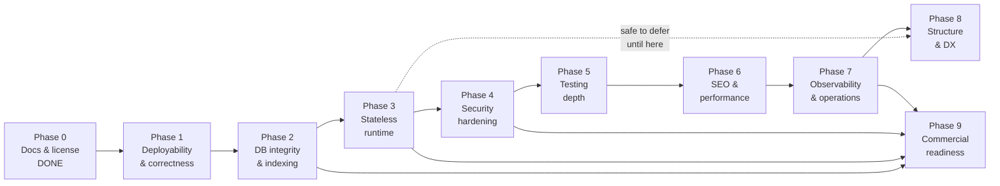

# Delivery Roadmap

**Project:** Spice & Saffron — Indian Café & Restaurant Commerce + Operations Platform
**Owner:** Himanshu ([@Himanshusingh204](https://github.com/Himanshusingh204) · himanshuyt21361@gmail.com)
**Document status:** Living plan — re-estimated at the end of Phase 1 and reviewed at the start of every phase
**Last updated:** 2026-10-15
**License:** Proprietary — personal use only. Commercial use requires contacting the owner.

This roadmap is the execution companion to [`MASTER_PLAN.md`](./MASTER_PLAN.md) (architecture,
SLOs, capacity model) and [`AUDIT.md`](./AUDIT.md) (evidence for every finding referenced here).
It contains **only** sequenced, verifiable work. Every finding ID (P0-x / P1-x / P2-x / P3-x)
resolves to a row in the audit.

---

## Table of contents

1. [How to read this roadmap](#1-how-to-read-this-roadmap)
2. [Phase overview](#2-phase-overview)
3. [Phase 0 — Documentation & licensing](#3-phase-0--documentation--licensing-done)
4. [Phase 1 — Deployability & correctness](#4-phase-1--deployability--correctness)
5. [Phase 2 — Database integrity & indexing](#5-phase-2--database-integrity--indexing)
6. [Phase 3 — Stateless runtime](#6-phase-3--stateless-runtime)
7. [Phase 4 — Security hardening](#7-phase-4--security-hardening)
8. [Phase 5 — Testing depth](#8-phase-5--testing-depth)
9. [Phase 6 — SEO & performance](#9-phase-6--seo--performance)
10. [Phase 7 — Observability & operations](#10-phase-7--observability--operations)
11. [Phase 8 — Structure & developer experience](#11-phase-8--structure--developer-experience)
12. [Phase 9 — Commercial readiness](#12-phase-9--commercial-readiness)
13. [Dependency graph](#13-dependency-graph)
14. [Sequencing rationale](#14-sequencing-rationale)
15. [Risk register](#15-risk-register)
16. [Definition of done](#16-definition-of-done-every-phase)
17. [Effort summary](#17-effort-summary)
18. [What good looks like at the end](#18-what-good-looks-like-at-the-end)

Companion documents referenced throughout: [`./AUDIT.md`](./AUDIT.md) ·
[`./MASTER_PLAN.md`](./MASTER_PLAN.md) · [`./DATABASE.md`](./DATABASE.md) ·
[`./ARCHITECTURE.md`](./ARCHITECTURE.md) · [`./OPERATIONS.md`](./OPERATIONS.md) ·
[`./TESTING.md`](./TESTING.md) · [`./SEO-AND-PERFORMANCE.md`](./SEO-AND-PERFORMANCE.md) ·
[`../SECURITY.md`](../SECURITY.md) · [`../CONTRIBUTING.md`](../CONTRIBUTING.md).

---

## 1. How to read this roadmap

### 1.1 The sequencing rule

> **Correctness and deployability come before optimisation. Always.**

A feature that cannot be deployed is worth nothing, and a fast system that leaks
money or cross-tenant data is worse than a slow one. Concretely, the ordering is:

```
Trust the money path  →  Trust the data  →  Trust the runtime  →  Harden  →  Prove
   (Phase 1)              (Phase 2)          (Phase 3)          (Phase 4-5)   (Phase 6-7)
```

Optimisation (Phase 6) and structure (Phase 8) are explicitly deferred because
they are **reversible and non-correctness**. Spending them early buys nothing and
risks entangling the critical fixes.

### 1.2 Delivery mechanics

| Rule | Detail |
| :--- | :--- |
| **One phase per PR** | A phase is a single reviewable, revertable unit. Sub-tasks may be separate commits **inside** the phase branch; they are never merged to `main` half-done. |
| **Independently shippable** | Every phase ends with `main` releasable and the full gate green ([definition of done](#16-definition-of-done-every-phase)). |
| **Independently revertable** | A phase must be revertable by reverting its commits or its migration, without reverting a later phase. Expand→contract migrations (Phase 2) exist for exactly this reason. |
| **No phase starts before its dependency's exit gate passes** | See the [dependency graph](#13-dependency-graph). |
| **Findings are the unit of closure** | Each finding ID is closed once, by one phase, with a test proving it. |
| **Measure, don't assert** | Any claim of "faster", "safe", or "deployed" must carry a command and its output. |

### 1.3 Finding severity (from the audit)

| Severity | Count | Meaning |
| :--- | :--- | :--- |
| 🔴 P0 | 5 | Data corruption, money loss, tenant leakage, or non-deployability |
| 🟠 P1 | 9 | Breaks at scale or in production; security weakness |
| 🟡 P2 | 11 | Correctness, performance, or maintainability debt |
| 🔵 P3 | 6 | Polish, accuracy, hygiene |

### 1.4 Verified baseline (measured 2026-10-15)

Every acceptance criterion below is phrased to build on this baseline.

| Check | Command | Baseline result |
| :--- | :--- | :--- |
| Types | `npx tsc --noEmit` | 0 errors |
| Lint | `npm run lint` | 0 warnings |
| Tests | `npx vitest run` | 148 passed / 27 files |
| Build | `npm run build` | Succeeds — 40 routes, 1 module-not-found warning, 1 slow-query warning |

**Pre-work status:** the in-flight work (stations, inventory, tables, waitlist,
loyalty) plus migration `20260905180000_add_stations_inventory_tables_loyalty` was
committed in `46998ea` on 2026-10-15, and the documentation layer in `f233136`.
Risk [R10](#15-risk-register) is therefore closed: the tree is clean and the gates
were green on the committed state.

### 1.5 A note on phase numbering

Commits that predate this roadmap use their own phase labels: `a17057b` "Phase 1"
(enterprise resilience — idempotency, cache-aside, job queue, DB telemetry) and
`022ab0c` "Phase 2.1" (dish modifiers, dine-in QR ordering, tipping, operating
hours, thermal chits). Those labels are **historical and unrelated** to the
numbering used here. This roadmap renumbers the forward plan from **Phase 0**, so
"Phase 1" in this document always means *Deployability & correctness* and never the
earlier resilience work.

---

## 2. Phase overview

| Phase | Theme | Primary outcome | Key findings fixed | Effort (size · eng-days) | Risk | Depends on | Exit gate |
| :--- | :--- | :--- | :--- | :--- | :--- | :--- | :--- |
| **0** | Documentation & licensing | Truthful repo, proprietary license, docs tracked | P3-1, P3-2, P3-3, P3-4 | ✅ Done · ~2 | Low | — | ✅ Complete |
| **1** | Deployability & correctness | Production API is reachable; money path is authoritative; emails actually send | P0-1, P0-4, P0-5, R10 | S–M · 5 | High value / low risk | Phase 0 | Deployed URL serves `/api/v1/orders`; 1 order ⇒ 1 row, 1 email, 1 object-store URL |
| **2** | Database integrity & indexing | `tenantId NOT NULL`, fail-closed tenant, real indexes, pooled connections | P0-3, P1-2, P1-7, P1-8, P2-1…P2-6 | M · 6 | Medium | Phase 1 | `NOT NULL` in schema; unknown tenant ⇒ 404; `EXPLAIN` shows Index Scan |
| **3** | Stateless runtime | Redis is required; durable outbox + worker; pub/sub; correct KDS fan-out | P0-2, P1-3, P1-4, P2-7, P2-8 | L · 10 | High | Phase 2 | Prod boot fails without Redis; 2 instances share cache/limits; outbox drains |
| **4** | Security hardening | Strict CORS, tighter CSP, RLS, scoped limits, honest auth claims | P1-1, P1-5, P1-6 (+ P1-3/4 enforcement) | M · 6 | Medium | Phase 3 | Unknown origin rejected; `npm audit --audit-level=high` clean; gitleaks clean |
| **5** | Testing depth | Contract, load, a11y, coverage and Lighthouse gates in CI | P2-9, P2-11, P3-6 | L · 10 | Medium | Phase 4 | Contract test green; coverage floor met; duplicate submits ⇒ 1 order |
| **6** | SEO & performance | Image pipeline ⇒ Lighthouse ≥ 95; complete metadata & typed JSON-LD | P1-9, P2-10 | M · 5 | Low | Phase 5 | Lighthouse mobile Perf ≥ 95; any image < 200 KB |
| **7** | Observability & ops | Traces, RED metrics, health vs readiness, alerts, restore drill | P1-2 monitoring, operational debt | M · 6 | Low | Phase 6 | Readiness reports degraded when Redis is down; restore drill passes |
| **8** | Structure & DX | `domain/` + `infrastructure/`, ADRs, dead code, package identity | P3-5, P3-6 (part) | M · 5 | Medium | Phase 3 (safe), best after 7 | `lib/` split merges with no behaviour change; gates still green |
| **9** | Commercial readiness | Onboarding, plan quotas, billing hooks, tenant admin, SLA docs | Product gap | XL · 15 | High | Phases 2, 3, 4, 7 | A second tenant self-serves end-to-end under an enforced plan |

**Total indicative effort:** ~70 engineer-days (see [§17](#17-effort-summary)).

---

## 3. Phase 0 — Documentation & licensing (DONE)

### Goal

Make the repository honest about what it is, give it a real license, and make the
professional documentation set trackable in git.

### Delivered

- [x] Truthful, GitHub-renderable `README.md` (no broken HTML block, no inflated metrics, correct env var names).
- [x] `LICENSE` — **proprietary source-available**, personal use only; commercial use requires contacting Himanshu; copyright Himanshu.
- [x] Professional documentation set under `docs/` (this roadmap, the master plan, the audit).
- [x] `.gitignore` no longer silently ignores `docs/` so the documentation set can be committed.
- [x] `SECURITY.md` (disclosure + controls), `CONTRIBUTING.md`, `CHANGELOG.md`, `.editorconfig`, `.nvmrc`.

### Findings closed

| ID | Finding |
| :--- | :--- |
| P3-1 | README broken on GitHub (HTML `<div>` closed by a blank line; `style=` stripped by the sanitiser) |
| P3-2 | README linked to gitignored `HANDOFF.md` / `AI_CONTEXT.md` (404s) |
| P3-3 | README claimed MIT with no `LICENSE`; stale metrics; wrong env var (`RESEND_API_KEY` vs `EMAIL_API_KEY`) |
| P3-4 | `.gitignore` ignored `/docs/`, which would silently unpublish the docs set |

### Acceptance criteria

- [x] `README.md` renders on GitHub with no stray tags and no dead links to `HANDOFF.md` / `AI_CONTEXT.md`.
- [x] `LICENSE` exists, names Himanshu, and states the personal-use / commercial-contact terms.
- [x] `SECURITY.md`, `CONTRIBUTING.md`, `CHANGELOG.md`, `.editorconfig`, `.nvmrc` exist.

> **Residual verification — confirmed 2026-10-15:** the docs set is now tracked by
> git. `README.md`, `.gitignore`, `package.json`, `LICENSE`, `SECURITY.md`,
> `CONTRIBUTING.md`, `CHANGELOG.md`, `.editorconfig`, `.nvmrc` and the whole of
> `docs/` were committed in `f233136`, so Phase 0's stated outcome — `docs/`
> tracked — is true, and risk [R10](#15-risk-register) no longer applies.

### Rollback

Documentation-only; revert the doc/license commits. No runtime impact.

### Risks

- **Low.** Documentation drift if later phases forget to update docs — mitigated by
  the [definition of done](#16-definition-of-done-every-phase) requiring docs +
  `CHANGELOG` updates in the same change.

**Cross-reference:** [`../SECURITY.md`](../SECURITY.md) · [`../CONTRIBUTING.md`](../CONTRIBUTING.md).

---

## 4. Phase 1 — Deployability & correctness

### Goal

The single most valuable phase: make the platform **actually deploy**, make the
**order money path authoritative on both adapters**, and make confirmation emails
**actually send**. Nothing else is worth doing until this ships.

> The remaining work in this phase has a detailed, reviewable execution plan —
> including the evidence for every decision and the open questions:
> **[plans/phase-1-completion.md](./plans/phase-1-completion.md)**. This section
> stays the source of truth for *what* is left; the plan is the source of truth
> for *how* and *why*.

### Progress — 2026-10-15 (partial)

- [x] In-flight work committed (`46998ea`); working tree clean; gates green.
- [x] Order creation delegates to `lib/services/orders.ts` — the Route Handler no
      longer trusts a client-supplied price (closes the P0-1 API surface).
- [x] Collision-resistant order numbers (`ORD-YYMMDD-XXXXXX`) with a
      unique-violation retry.
- [x] `EMAIL_DISPATCH` sends through the notifier and fails loudly so the queue
      retries and dead-letters; customer receipts fire on order creation
      (closes P0-5).
- [x] `createOrder` accepts and persists `tenantId`.
- [x] Uploads (P0-4): object storage is now a driver-based abstraction
      (`lib/storage/`) with a vendor-neutral S3-compatible driver, magic-byte
      validation, a size cap and metadata stripping. The base64 `data:` fallback
      is deleted; uploads fail closed with `503` when unconfigured.
- [x] Tests added: order pricing (tamper / out-of-stock / ad-hoc / tenant),
      order-number entropy, email-dispatch behaviour, storage resolution /
      validation, and request-guard units. Suite is **192 tests across 31 files**.
- [x] Idempotency key + rate limit on the Next.js order route. A new
      `lib/api/request-guards.ts` provides header parsing, payload hashing and
      the acquire/complete/release wrappers, so the route stays declarative.
      `POST /api/v1/orders` now runs auth → fail-closed backend check → parse →
      validate → rate limit (`orders:create:<apiKeyId>`, 60/60 s, `429` +
      `Retry-After`) → dedupe. The idempotency scope is
      `tenantId:orders.create:<key>` and the request body is fingerprinted
      alongside it, so a replayed key returns the original order while a key
      reused for a *different* body is rejected with `409` — a mutated retry can
      never book a second order, and a concurrent duplicate gets `409` instead
      of a second row.

- [x] `vercel.json` reconciled (P0-4 remainder). The build delegates to
      `scripts/vercel-build.mjs`, which applies migrations for **production
      builds only** — preview and development builds skip them, so a branch
      deploy can no longer migrate the production database. The KDS and
      notification streams declare their `maxDuration` budget explicitly, and
      `scripts/verify-deployment.mjs` now probes the API surface (`401`, not
      `404`, without credentials) plus the public waitlist route, so "the API is
      deployed" is tested rather than assumed.

Still open in this phase:

- [ ] `server/api.ts` trimmed to a thin adapter (it still owns menu caching).
- [ ] Minimal two-adapter parity smoke (the full contract test is Phase 5).
- [x] Replace the hardcoded 5 % GST and float money in `lib/services/orders.ts` (P1-7).
      `lib/money/` holds all arithmetic in integer paise with a single half-up
      rounding primitive and converts to the `Decimal(10,2)` column as an exact
      string; the rate is configuration (`config/pricing.ts`, `TAX_RATE_PERCENT`).
      The checkout page had its own `Math.round(subtotal * 0.05)` and now shares
      the same rule (`lib/money/cart.ts`) with the server. Per-tenant rates need
      the Phase 2 `Tenant` column (plan D1).

### 1.1 Pre-work — protect in-flight work (R10)

- [x] Review the uncommitted Phase 2.2 diff (`git status`, `git diff`).
- [x] Commit it on a feature branch **with** its migration `20260905180000_add_stations_inventory_tables_loyalty`, or stash it behind a named tag. _(Committed as `46998ea`.)_
- [x] Confirm `npx tsc --noEmit`, `npm run lint`, `npx vitest run` are green **on the committed state** before starting Phase 1.
- [x] Do not let the Phase 1 diff and the Phase 2.2 diff share a commit.

### 1.2 Decide and implement the Vercel-native API path

- [x] Confirm the decision: `app/api/v1/*` Route Handlers are the **primary production API**; `server/api.ts` is retained for self-hosting, long-running workers and local dev.
- [ ] Make `server/api.ts` a **thin adapter** over `lib/services/*` — remove business logic from the adapter.
- [ ] Add an order-creation endpoint parity check between the two adapters (full contract test lands in Phase 5; a minimal smoke now).
- [x] Add `runtime = "nodejs"` where Node APIs (Prisma, `sharp`, Redis) are required.
- [x] Document the two-runtime contract in `docs/ARCHITECTURE.md`.

### 1.3 Fix P0-1 — price tampering on the B2B order route

- [x] Delete the client-supplied pricing in `app/api/v1/orders/route.ts` (`:22`, `:93–96`). The schema must accept `dishId` + `quantity` + modifiers, never `price`.
- [x] Delegate order creation to `lib/services/orders.ts#createOrder` so pricing, coupon validation, loyalty accrual, inventory/auto-86 run in one place.
- [ ] Replace the hardcoded 5% tax with the tenant's configured tax rate.
- [x] Route discount through the coupon engine (the service's coupon path; the adapter no longer computes discounts).
- [x] Add Redis-backed rate limiting and idempotency on `POST /api/v1/orders`. Wired via `lib/api/request-guards.ts`: 60 requests / 60 s per API key, `409` on a concurrent duplicate, `503` when a production deployment has no shared backend. Phase 3 adds the boot-time assertion and removes the silent in-memory fallback.
- [x] Fix `orderNumber` generation to be collision-safe: DB-uniqueness with bounded retry, not `Date.now()` + 4 random digits.
- [x] Add anti-tampering tests asserting a client-supplied price is ignored and the DB price is charged.

### 1.4 Fix P0-4 — deployable API + safe uploads

- [x] Install `@vercel/blob` (or implement an S3-compatible client) — pick one and remove the other path. _(Chose the vendor-neutral S3-compatible client, `@aws-sdk/client-s3`.)_
- [x] Rewrite `app/api/upload/route.ts` to persist only the **object URL** in Postgres; never a `data:` base64 URL.
- [x] Fail the upload loudly when object storage is unavailable (no silent fallback) — `503`.
- [x] Add MIME + magic-byte sniffing and a hard size cap.
- [x] Remove the `Module not found: Can't resolve '@vercel/blob'` build warning.
- [x] Reconcile `vercel.json` with the runtime decision; the API must be reachable on the deployed URL. _(Build delegates to `scripts/vercel-build.mjs`, which applies migrations for production builds only, and `scripts/verify-deployment.mjs` now asserts the API surface — see the plan's workstream A.)_

### 1.5 Fix P0-5 — emails never sent

- [x] Make the `EMAIL_DISPATCH` handler in `lib/queue/handlers.ts` call `lib/email/notifier.ts`.
- [x] Make the handler **throw on failure** so retry/DLQ engages; never log success for an unsent email.
- [x] Remove the false "confirmation sent" claim in `server/api.ts` (or make it true). _(It is now true: the webhook enqueues a real send.)_
- [x] Add a test asserting the notifier is invoked with the order's recipient and that a notifier failure fails the job.

### Findings closed

| ID | Finding | Evidence pointer | Status |
| :--- | :--- | :--- | :--- |
| P0-1 | Client-controlled pricing; hardcoded tax; colliding `orderNumber` | `app/api/v1/orders/route.ts:22,93–96,98–99,47` | **Fully fixed.** Server-authoritative pricing, order numbers, idempotency, rate limiting, and (2026-10-15) the hardcoded 5 % tax and float money — now `lib/money/` in integer paise with a configured rate. A per-tenant rate is Phase 2. |
| P0-4 | API undeployable on Vercel; base64 `data:` uploads persisted to Postgres | `vercel.json`, `app/api/upload/route.ts:63–91` | **Fixed** — S3-compatible `lib/storage/` for uploads, production-only migrations and API-surface probes in `scripts/vercel-build.mjs` / `scripts/verify-deployment.mjs`. |
| P0-5 | Confirmation emails only logged, never sent | `lib/queue/handlers.ts:65–74`, `server/api.ts:292–299` | **Fixed** — the handler sends and fails loudly; a receipt is sent on order creation. |
| R10 | Uncommitted Phase 2.2 work | `git status` | **Fixed** — committed in `46998ea`. |

### Acceptance criteria

| # | Criterion | Command / evidence | Expected |
| :-- | :--- | :--- | :--- |
| 1 | Types clean | `npx tsc --noEmit` | 0 errors |
| 2 | Lint clean | `npm run lint` | 0 warnings |
| 3 | Tests green and grown | `npx vitest run` | ≥ 148 passed, 0 failures; **new** anti-tampering + email tests present |
| 4 | Build clean | `npm run build` | Succeeds; **0** module-not-found warnings |
| 5 | Deployed API answers | `curl -i $PROD_URL/api/v1/orders` (unauth) | `401/403`, not `404`/`502` |
| 6 | Price authority | Integration test: submit `price: 0.01` for a ₹300 dish | Order total reflects ₹300 |
| 7 | One order, one row | Duplicate `POST` with the same `Idempotency-Key` | Exactly one `Order` row |
| 8 | Email sends | Test with a mocked notifier | Notifier called once with the order recipient |
| 9 | No binary in DB | Inspect the uploaded row | `imageUrl` is an object-store URL, not `data:` |
| 10 | In-flight work preserved | `git log --oneline -5` on the merge base | Phase 2.2 commit present before Phase 1 |

### Rollback plan

- Revert the Phase 1 commits. The API reverts to the prior (non-deployable) state,
  which is acceptable only because it was never deployed.
- The storage dependency is additive; reverting removes `@aws-sdk/client-s3` and `lib/storage/`.
- The in-flight Phase 2.2 branch is untouched by a Phase 1 revert because it is committed separately.
- No destructive migration in Phase 1.

### Risks

- **Medium — removing the client price field may break an unlisted caller.** Mitigate by documenting the new contract and returning a `400` with the offending field named.
- **Medium — object-store choice locks the deploy target.** Mitigate by keeping the storage call behind one module so a different provider can drop in.
- **Low — email provider misconfiguration makes jobs retry forever.** Mitigate: retries are bounded and terminate in the DLQ (Phase 3), with alerts (Phase 7).

---

## 5. Phase 2 — Database integrity & indexing

### Goal

Make the data layer **correct by construction** (`tenantId NOT NULL`, fail-closed
tenant resolution) and **fast for its real queries** (composite/partial indexes),
with bounded connection pooling that survives serverless.

**Detail:** full DDL, pool reasoning and `EXPLAIN` evidence live in [`DATABASE.md`](./DATABASE.md).

### 2.1 Tenant integrity (P0-3)

- [ ] Backfill `tenantId` on every tenant-scoped table with a data migration.
- [ ] Change `tenantId` to `NOT NULL` using **expand → backfill → contract** (no table lock on a live table).
- [ ] Make `resolveTenant` in `lib/db/tenant.ts` **fail closed**: unknown/inactive slug ⇒ `404`, never the default tenant.
- [ ] Remove `getOrCreateDefaultTenant()` from hot read paths and from every SSE connect (`app/api/v1/realtime/kds/route.ts:39`).
- [x] Cache the tenant lookup (TTL) so resolution is not a per-request write. (2026-10-23: 60 s in-process cache, `updateTenant` invalidates; read path never writes outside the default-tenant dev path.)
- [ ] Replace every `OR: [{ tenantId }, { tenantId: null }]` with a strict equality filter (`app/api/v1/orders/route.ts:47`, `server/api.ts:164,192`).
- [ ] Add tenant-crossover security tests (request tenant B data with tenant A credentials ⇒ `404`/`403`, never data).

### 2.2 Indexes for real query shapes (P2-1…P2-3)

- [ ] Add the menu composite index serving `WHERE categoryId=? AND isAvailable=true AND deletedAt IS NULL ORDER BY sortOrder` — e.g. `(categoryId, isAvailable, deletedAt, sortOrder)`, partial `WHERE deletedAt IS NULL`.
- [ ] Add cursor-friendly composites for `Order` (`tenantId`, `orderStatus`, `createdAt desc`), `ContactMessage`, `ActivityLog`, `LoyaltyLedger`, `WaitlistEntry`.
- [ ] Drop redundant duplicate indexes that shadow a `@unique` (`Tenant.slug`, `Category.slug`, `Dish.slug`, `Coupon.code`, `ApiKey.keyHash`, `Admin.email`).
- [ ] Create all indexes with `CONCURRENTLY` in production (off-peak), and version optimistically.
- [ ] Attach `EXPLAIN (ANALYZE, BUFFERS)` before/after to the PR.

### 2.3 Multi-tenancy completeness (P2-4, P2-5)

- [x] Add `tenantId` to the four orphan contexts: `GalleryImage`, `ContactMessage`, `Review`, `Setting` (and `Coupon`). (2026-10-23, also `Category`/`Dish` NOT NULL.)
- [x] Replace globally-unique keys with tenant-scoped uniqueness: `(tenantId, slug)` on `Category`/`Dish`, `(tenantId, code)` on `Coupon`, `(tenantId, key)` on `Setting` (done 2026-10-23). `Admin.email` stays global: login is by email alone, so per-tenant email needs a tenant-aware login first.
- [ ] Make `orderNumber` unique per `(tenantId, orderNumber)` instead of globally (P1-8).

### 2.4 Money correctness (P1-7) — arithmetic **done** in Phase 1; tenant rate remains

- [x] Replaced float arithmetic with integer minor units on the pricing path — `lib/money/` (`toMinorUnits`, `applyRatePercent`, `roundHalfUp`, `toDecimalString`) with a single shared cart rule in `lib/money/cart.ts`. `server/api.ts` still reads `Number(d.price)` for display; the *pricing* path is exact on both runtimes.
- [x] Half-up rounding once per derived amount; `Decimal(10,2)` at the boundary via an exact fixed-point string; currency is explicit (`config/pricing.ts` → `pricing.currency`).
- [x] Money-rounding tests: `tests/unit/money.test.ts` (25 cases: boundaries, negatives, malformed input, discount + tax + tip permutations) plus DB-backed assertions in `tests/unit/order-pricing.test.ts`.
- [ ] **Phase 2:** add `Tenant.taxRatePercent` (and currency) so the rate is per-tenant rather than global; the call site already reads it (`resolveTaxRatePercent`).

### 2.5 Connections & transactions (P1-2)

- [x] Add explicit pool bounds in `lib/db/prisma.ts`: `max` per runtime, `idleTimeoutMillis`, `connectionTimeoutMillis`, `statement_timeout`, `application_name`.
- [x] Use pooler-compatible settings (PgBouncer transaction-mode safe) and `max ≈ 1–5` for serverless, `10–20` for the worker.
- [ ] Add a `withTransaction` helper with bounded retries for serialization failures.

### Findings closed

P0-3 · P1-2 · P1-7 · P1-8 · P2-1 · P2-2 · P2-3 · P2-4 · P2-5 · P2-6.

### Acceptance criteria

| # | Criterion | Command / evidence | Expected |
| :-- | :--- | :--- | :--- |
| 1 | Gates green | `npx tsc --noEmit` · `npm run lint` · `npx vitest run` · `npm run build` | 0 errors, 0 warnings, 0 test failures, build succeeds |
| 2 | `tenantId` mandatory | Inspect `prisma/schema.prisma` | Every tenant-scoped model has non-optional `tenantId` |
| 3 | Tenant fails closed | Request an unknown slug | HTTP `404`; **no** default-tenant data returned |
| 4 | No `OR … null` filters | `rg "tenantId: null"` over `app/` + `server/` | **0** matches |
| 5 | Menu query indexed | `EXPLAIN (ANALYZE, BUFFERS)` on the menu query | **Index Scan**, not Seq Scan; the 195 ms `Dish.findMany` warning is gone from `npm run build` |
| 6 | Duplicate indexes gone | Compare index list before/after | Redundant `@@index([slug/email/code/keyHash])` removed |
| 7 | Money is not float | `rg "Number\(.*price"` in pricing paths | **0** matches |
| 8 | Pool bounded | Inspect `lib/db/prisma.ts` | `max`, `idleTimeoutMillis`, `connectionTimeoutMillis`, `statement_timeout` set |
| 9 | Crossover blocked | Security test suite | Tenant-crossover tests pass |
| 10 | Migration reversible | Migration down path | `down`/drop SQL present and reviewed; `EXPLAIN` recorded in PR |

### Rollback plan

- Index changes: `DROP INDEX` (or the down migration).
- `tenantId NOT NULL`: reversible only **after** the contract step; expand+backfill are
  additive and safe to leave in place. Backfill is idempotent.
- Tenant-scoped unique keys: created with `CREATE UNIQUE INDEX CONCURRENTLY`; drop on revert.
- Pool bounds: config-only; revert the commit.
- **Never** drop a column in the same phase that adds its replacement (contract happens only after the new path is proven).

### Risks

- **Medium — `NOT NULL` on a live table locks.** Mitigate with expand→backfill→contract and an off-peak window.
- **Medium — a backfill on a large table runs long.** Mitigate with batched updates and a monitored `statement_timeout`.
- **Low — a new composite index slows writes.** Mitigate by dropping the single-column index the composite prefix already covers.

---

## 6. Phase 3 — Stateless runtime

### Goal

Remove the largest correctness risk: **no production state in process memory.**
Cache, rate limit, idempotency and pub/sub become shared (Redis); background work
becomes a **durable, DB-backed outbox** drained by a worker + Vercel Cron.

### 3.1 Redis as a hard production dependency (P0-2)

- [x] Add a boot-time assertion: refuse to start in production when Redis is unconfigured.
- [ ] Make `lib/cache/cache-manager.ts`, `lib/rate-limit/limiter.ts` and `lib/resilience/idempotency.ts` require Redis in production; keep in-memory **strictly** for dev/test.
- [ ] Remove the silent, unconditional in-memory fallback (the capability already exists; stop degrading quietly).
- [ ] Replace `lib/realtime/bus.ts` `EventEmitter` with **Redis pub/sub** for KDS fan-out.
- [ ] Make the order write path publish events only to the shared bus.

### 3.2 Durable outbox queue (P0-2)

> **Status (partial):** `OutboxEvent` table + `lib/outbox` (enqueue in-transaction, `processOutbox` with `FOR UPDATE SKIP LOCKED`, backoff, DEAD) + `/api/cron/outbox` shipped; order receipts migrated. Open: Redis hard-dependency decision, moving webhook/KDS jobs onto the outbox, outbox depth metrics.

- [ ] Add an outbox table (event type, payload, status, attempts, `availableAt`, `tenantId`).
- [ ] Insert outbox events **inside** the order transaction (no side effect before commit).
- [ ] Replace `lib/queue/job-queue.ts` in-process queue + `setInterval` with an outbox worker.
- [ ] Drain the outbox from a worker process **and** a Vercel Cron trigger (serverless is frozen between requests).
- [ ] Implement exponential backoff → dead-letter with retained payload + replay path.
- [ ] Provide idempotent handlers (email, webhook, KDS) so at-least-once delivery is safe.

### 3.3 Fix cache invalidation & idempotency (P1-3, P1-4)

- [ ] Replace the blocking `KEYS prefix*` in `lib/cache/cache-manager.ts:138` with `SCAN` cursors or versioned key prefixes.
- [x] Bind the idempotency key to `(tenantId, endpoint, payload hash)`; a reused key with a different body returns `409` instead of replaying. _(Implemented for `POST /api/v1/orders` in Phase 1 — `lib/api/request-guards.ts`. The Express `idempotencyMiddleware` still keys on the raw header alone; extending it to the same `(tenant, endpoint, payload)` scope is part of the Phase 1 two-adapter parity work.)_
- [ ] Persist the idempotency key so replay safety survives a cache flush.

### 3.4 Real metrics & correct fan-out (P2-7, P2-8)

- [x] (done, in-process counters; outbox depth/lag metrics still open) Make queue metrics meaningful under concurrency (depth, in-flight, lag, completed, failed) sourced from the outbox, not a per-process counter that can never exceed `1`.
- [x] (done in `server/app.ts`) Fix the KDS tenant key mismatch: the broadcast publishes `tenant:spice-saffron` (slug) while subscribers register with a UUID — publish and subscribe on the **same** tenant identifier (`server/api.ts:287` vs `realtime/kds/route.ts:40`).

### Findings closed

P0-2 · P1-3 · P1-4 · P2-7 · P2-8.

### Acceptance criteria

| # | Criterion | Command / evidence | Expected |
| :-- | :--- | :--- | :--- |
| 1 | Gates green | `npx tsc --noEmit` · `npm run lint` · `npx vitest run` · `npm run build` | 0 errors, 0 warnings, 0 failures, build OK |
| 2 | Redis required | Start prod without `REDIS_URL` | Process refuses to boot with a clear error |
| 3 | Shared state | Run **two** app instances behind a load balancer; hit cache + rate limit | Same cache value on both; combined request count respects one limit |
| 4 | Outbox durability | Create an order, restart the app before the worker runs | Job is still delivered after restart |
| 5 | No lost jobs on deploy | Deploy mid-queue | No job disappears; lag recovers to 0 |
| 6 | No blocking `KEYS` | `rg "KEYS"` in `lib/cache/` | **0** occurrences on the invalidation path |
| 7 | Idempotency bound | Reuse a key with a different body | `409 Conflict` |
| 8 | KDS fan-out | Ticket created on instance A, SSE on instance B | Ticket received (channel identifiers match) |
| 9 | Metrics real | Read queue metrics under concurrency | `processing` > 1 is representable; counts monotonic |

### Rollback plan

- Keep the in-memory implementations behind the same interface so a revert restores single-instance behaviour.
- The outbox is additive: the old queue path can be re-enabled by config for one release.
- Redis pub/sub revert restores the local `EventEmitter` (correct only for single-instance — acceptable as an emergency fallback, with an alert).

### Risks

- **High — Redis becomes a single point of failure.** Mitigate per the master plan: on Redis loss, bypass cache (slower, still correct) and fall back to a **local** rate limit; never fail an order because the cache is down.
- **High — outbox introduces at-least-once delivery.** Mitigate with idempotent handlers and a durable processed-key store.
- **Medium — worker + cron double-drain races.** Mitigate with row-level locking (`SELECT … FOR UPDATE SKIP LOCKED`) and a lease.

---

## 7. Phase 4 — Security hardening

### Goal

Close the remaining security weaknesses found by review, so the platform is
trustworthy for real traffic and real tenants.

### 4.1 CORS & headers (P1-1)

- [x] Replace the permissive Express CORS callback (`server/api.ts:29–42`, which returns `true` for every origin with `credentials: true`) with a **strict allowlist** derived from `APP_URL`.
- [x] Add `Idempotency-Key` to `allowedHeaders` (the middleware already expects it).
- [ ] Tighten CSP: remove `'unsafe-inline'` for scripts where feasible; document every exception.
- [ ] Add `Cross-Origin-Opener-Policy`, `Cross-Origin-Resource-Policy`, `X-DNS-Prefetch-Control`.

### 4.2 Auth hygiene (P1-5, P1-6)

- [x] Throttle/debounce the `lastUsedAt` write on the S2S hot path (e.g. update only when older than 60 s).
- [x] Correct the misleading constant-time claim in `lib/auth/s2s.ts` — the value was already matched by `findUnique({ keyHash })`, so `timingSafeEqual` here defends nothing. Fix the **documentation** (and keep the lookup, which is constant-time by construction).
- [ ] Enforce the S2S IP allowlist.

### 4.3 Isolation, limits & supply chain

- [ ] Add Postgres **RLS** policies as defence in depth behind the `NOT NULL`/fail-closed changes.
- [ ] Make rate limits tenant-scoped and per endpoint (login, order creation, coupon validation, contact, S2S).
- [ ] Raise CI audit to `npm audit --audit-level=high`.
- [ ] Add `gitleaks` secret scanning.
- [ ] Add Dependabot + lockfile-integrity check.

### Findings closed

P1-1 · P1-5 · P1-6 · P1-10 (plus enforcement hardening for P1-3/P1-4 from Phase 3).

### Acceptance criteria

| # | Criterion | Command / evidence | Expected |
| :-- | :--- | :--- | :--- |
| 1 | Gates green | `npx tsc --noEmit` · `npm run lint` · `npx vitest run` · `npm run build` | All clean |
| 2 | CORS strict | Preflight from an unknown origin | **Rejected** (no `Access-Control-Allow-Origin`) |
| 3 | CORS allowlisted | Preflight from the configured origin | Allowed; `Idempotency-Key` accepted |
| 4 | Headers present | `curl -I` a page | CSP, COOP, CORP, `X-Content-Type-Options`, `X-Frame-Options`, `Referrer-Policy` present |
| 5 | Throttled write | Inspect S2S path | `lastUsedAt` updated at most ~once per 60 s |
| 6 | Docs honest | `rg "constant-time|side-channel" lib/auth/s2s.ts` | Comment matches reality |
| 7 | RLS enforced | Query cross-tenant as a non-owner role | Denied |
| 8 | Audit clean | `npm audit --audit-level=high` | 0 high/critical |
| 9 | No secrets | `gitleaks` (CI) | 0 leaks |

### Rollback plan

- Header/CORS changes: revert the config commit; CORS immediately returns to the (unsafe) permissive behaviour only in the reverted build.
- RLS: policies are additive; disable per table via `ALTER TABLE … DISABLE ROW LEVEL SECURITY` if a false positive blocks traffic.
- Rate limits: tune or disable via config without a schema change.

### Risks

- **Medium — a too-strict CORS allowlist breaks a legitimate first-party caller.** Mitigate by logging rejected origins for one release before enforcing.
- **Medium — RLS misconfiguration blocks legitimate reads.** Mitigate by rolling out per table with monitoring and an instant disable path.
- **Low — tighter CSP breaks inline-dependent UI.** Mitigate with a report-only window first.

---

## 8. Phase 5 — Testing depth

### Goal

Turn "it works on my machine" into **provable at scale**: contract, load,
accessibility, coverage and Lighthouse gates, plus E2E and security coverage.

### 5.1 Contract & adapter parity (P2-9)

- [ ] Add contract tests asserting the Next Route Handler and `server/api.ts` return byte-compatible payloads for the same input; CI fails on divergence.
- [ ] Cover the previously untested Express surface: menu, orders, coupons, SSE, webhook, metrics.

### 5.2 Load & concurrency

- [ ] Add k6/autocannon load tests for menu read, order write, and SSE fan-out; publish p95 baselines.
- [ ] Add concurrency/idempotency tests: N parallel duplicate submits ⇒ **exactly one** order.

### 5.3 Quality gates (P2-11, P3-6)

- [ ] Install `@vitest/coverage-v8`, add a `coverage` block, and set a floor on `lib/services/**` and `lib/auth/**`.
- [ ] Add `axe-core` a11y assertions in Playwright on every public page (zero critical violations).
- [ ] Add Lighthouse CI budget assertions (see Phase 6 for the numbers).
- [ ] Extend E2E: checkout, order tracking, loyalty, waitlist, inventory-86.
- [ ] Add IDOR/tenant-crossover security tests (orders, reservations, loyalty).
- [ ] Add the new gates to `.github/workflows/` and a nightly load-test job.

### Findings closed

P2-9 · P2-11 · P3-6 (CI gates).

### Acceptance criteria

| # | Criterion | Command / evidence | Expected |
| :-- | :--- | :--- | :--- |
| 1 | Gates green | `npx tsc --noEmit` · `npm run lint` · `npm run build` | Clean |
| 2 | Suite grown | `npx vitest run` | ≥ 148 passed, 0 failures, **including** new contract/concurrency/security tests |
| 3 | Coverage floor | `npx vitest run --coverage` | Meets the configured floor on `lib/services/**` and `lib/auth/**` |
| 4 | Contract enforced | Deliberately diverge an adapter response | CI **fails** |
| 5 | One order under race | Parallel duplicate submits | **1** `Order` row |
| 6 | Load baseline published | k6/autocannon report | p95 recorded for menu/order/SSE |
| 7 | A11y | `axe-core` in Playwright | 0 critical violations on public pages |
| 8 | IDOR blocked | Security suite | Cross-tenant access denied in every case |

### Rollback plan

- CI gates are additive; if a gate is mis-tuned it can be relaxed to a warning while the tests stay.
- Load tests run in a nightly job, not on the critical path; reverting removes noise, not protection.

### Risks

- **Medium — coverage floors can incentivise low-value tests.** Mitigate by scoping the floor to `lib/services/**` and `lib/auth/**` (the money and identity paths), not a global percentage.
- **Medium — load tests are environment-sensitive.** Mitigate by running against a fixed profile and comparing to a stored baseline rather than an absolute.
- **Low — a11y/Lighthouse flakiness blocks merges.** Mitigate with deterministic budgets and a documented rerun policy.

---

## 9. Phase 6 — SEO & performance

### Goal

Make the storefront fast enough to hit the Lighthouse budget and complete enough
to be found. **The single highest-leverage item in the entire plan is the image
pipeline.**

**Detail:** budgets and baseline asset weights live in [`SEO-AND-PERFORMANCE.md`](./SEO-AND-PERFORMANCE.md).

### 6.1 Image pipeline (P1-9)

- [ ] Convert all shipped images to AVIF/WebP and generate responsive sizes.
- [ ] Serve every image via `next/image` with explicit `sizes`.
- [ ] Preload the LCP image (`public/images/hero/hero-dining.jpg`, 951 KB today).
- [ ] Target **≥ 90% byte reduction** per asset; enforce **any single image < 200 KB**.

### 6.2 Metadata & structured data (P2-10)

- [ ] Add per-page `alternates.canonical`.
- [ ] Add an `opengraph-image` route.
- [ ] Add a web manifest.
- [ ] Replace the hardcoded JSON-LD literal in `app/layout.tsx` with typed generation: `Menu`/`MenuSection`/`MenuItem`, `BreadcrumbList`, `FAQPage`, `LocalBusiness` + `aggregateRating` **from `config/site.ts`** (single source of truth).

### 6.3 JS, fonts & caching

- [ ] Review the `framer-motion` JS budget; prefer CSS for simple reveals or lazy-load motion components to protect INP/TBT.
- [ ] Subset and preload only the critical font face (`next/font` self-hosted).
- [ ] Add long-lived immutable cache headers for hashed assets; `stale-while-revalidate` for HTML.
- [ ] Verify the cart drawer, checkout modal and KDS board are not in the initial storefront bundle.

### Findings closed

P1-9 · P2-10.

### Acceptance criteria

| # | Criterion | Command / evidence | Expected |
| :-- | :--- | :--- | :--- |
| 1 | Gates green | `npx tsc --noEmit` · `npm run lint` · `npx vitest run` · `npm run build` | All clean |
| 2 | Lighthouse (mobile) | Lighthouse CI on the home page | Performance **≥ 95**, Accessibility **100**, Best Practices **100**, SEO **100** |
| 3 | Core Web Vitals | Lighthouse mobile, 4G | LCP **< 2.0 s**, CLS **< 0.05**, INP **< 200 ms** |
| 4 | Any single image | Inspect `public/images/**` | Every asset **< 200 KB** |
| 5 | Byte reduction | Before/after asset sizes | **≥ 90%** reduction per converted asset |
| 6 | JSON-LD from config | Inspect generated markup + `app/layout.tsx` | No duplicated address/phone/hours literal |
| 7 | Canonicals | Inspect page `<head>` | Correct per-page canonical on every public route |
| 8 | JS budget | Bundle analysis of a public route | First-load JS `< 150 KB` gzip |

### Rollback plan

- Image conversion: keep originals in a source directory; revert the pipeline commit.
- Metadata/JSON-LD: revert the commit; the prior hardcoded literal restores.
- Caching headers: config-only revert.

### Risks

- **Low — a format choice hurts older browsers.** Mitigate with `next/image` format negotiation (AVIF/WebP with fallback).
- **Low — preloading the wrong asset regresses LCP.** Mitigate by measuring LCP element before and after.
- **Certain without action — image weight makes 100 Performance impossible** (risk [R5](#15-risk-register)).

---

## 10. Phase 7 — Observability & operations

### Goal

Make the running system **legible**: traces, metrics, truthful health checks,
actionable alerts that link to runbooks, and a backup that has actually been
restored.

**Detail:** runbooks and SLOs in [`OPERATIONS.md`](./OPERATIONS.md).

### 7.1 Tracing & metrics

- [ ] Add OpenTelemetry tracing (HTTP → service → Prisma → outbound); correlate with `requestId`.
- [ ] Add RED metrics per route (Rate, Errors, Duration).
- [ ] Add queue/outbox lag, outbox depth, cache hit ratio, pool saturation, SSE connections, failed-webhook rate.
- [ ] Ship structured logs to a log platform; never log secrets or raw PII.

### 7.2 Health, alerts & runbooks

- [ ] Split `/api/health` (liveness) from a **readiness** probe that checks DB **and** Redis.
- [ ] Readiness reports **degraded** (not dead) when only Redis is down.
- [ ] Add dashboards (ops + business) and alerts for 5xx rate, p95 latency, queue lag, pool exhaustion, webhook failure, failed logins.
- [ ] Every alert links to a runbook entry; delete alerts with no action.

### 7.3 Backup, restore & DR

- [ ] Verify automated daily backup + PITR on the managed Postgres provider.
- [ ] Run a **restore drill**: restore to a scratch DB, run migrations, verify row counts and a smoke suite.
- [ ] Document RPO ≤ 5 min, RTO ≤ 1 h (per the master plan SLOs).

### Findings closed

Operational debt from the audit (monitoring gap for P1-2 pool saturation, queue metrics, SSE connections); no new P0/P1 IDs.

### Acceptance criteria

| # | Criterion | Command / evidence | Expected |
| :-- | :--- | :--- | :--- |
| 1 | Gates green | `npx tsc --noEmit` · `npm run lint` · `npx vitest run` · `npm run build` | All clean |
| 2 | Liveness | `curl -i /api/health` | `200` when the process is up |
| 3 | Readiness degraded | Stop Redis, call readiness | Reports **degraded**, not dead; no false `503` for cache-only outage |
| 4 | Traces | OpenTelemetry export | HTTP → service → Prisma span chain visible |
| 5 | RED metrics | Metrics endpoint/dashboard | Per-route rate/errors/duration present |
| 6 | Alerts actionable | Trigger a 5xx spike in staging | Alert fires and links to a runbook |
| 7 | Restore drill | Restore to scratch DB + smoke suite | Passes; RTO measured and documented |

### Rollback plan

- Tracing/metrics: feature-flagged; disable the exporter without affecting correctness.
- Health split: revert the route change.
- Alerts/dashboards: revert config; no runtime impact.

### Risks

- **Low — telemetry cost/overhead.** Mitigate with sampling and per-signal budgets.
- **Low — alert fatigue.** Mitigate by the "no runbook ⇒ delete the alert" rule.

---

## 11. Phase 8 — Structure & developer experience

### Goal

Pay down structural debt so the codebase can absorb the remaining phases and
future contributors. **Explicitly safe to defer until after Phase 3** — this is
cosmetic-by-comparison and reversible.

### 8.1 Structure

- [ ] Split `lib/` into `domain/` (services, rules) and `infrastructure/` (db, cache, queue, auth, email, payments).
- [ ] Keep imports stable via re-export shims so the split lands as a mechanical, reviewable change.
- [ ] Remove dead code identified during the audit.
- [ ] Add ADRs for the decisions this roadmap fixes (Vercel-native API, Redis-required, durable outbox, RLS).

### 8.2 Developer experience

- [ ] Fix the Vite ESM-in-CJS config warning in `vitest.config.ts` (it will break under a future Vite default — P3-6).
- [ ] Professional `package.json` identity: `name: spice-and-saffron`, `author`, `license`, `engines` (P3-5).
- [ ] Keep docs in sync (`docs/`, `FILE_STRUCTURE.md`, README) as part of every change.

### Findings closed

P3-5 · P3-6 (Vite ESM-in-CJS warning; package identity). Structural debt (no dedicated ID).

### Acceptance criteria

| # | Criterion | Command / evidence | Expected |
| :-- | :--- | :--- | :--- |
| 1 | Gates green | `npx tsc --noEmit` · `npm run lint` · `npx vitest run` · `npm run build` | All clean — **no behaviour change** |
| 2 | Split landed | Repository tree | `lib/domain/**` + `lib/infrastructure/**` exist; old paths re-export or are removed |
| 3 | Warning gone | `npx vitest run` output | No Vite ESM-in-CJS warning |
| 4 | Identity | Inspect `package.json` | `name`, `author`, `license`, `engines` present |
| 5 | ADRs | `docs/adr/*` | One ADR per major decision |

### Rollback plan

- The split is a move + re-export; revert the commit restores `lib/*` wholesale.
- `package.json` identity and config fixes are trivially revertable.

### Risks

- **Medium — a large mechanical move hides a behaviour change.** Mitigate with re-export shims, a diff-review checklist, and the unchanged test suite as the safety net.
- **Low — contributors rebase pain.** Mitigate by landing the split in a quiet window after Phase 3.

---

## 12. Phase 9 — Commercial readiness

### Goal

Turn a technically sound single-café platform into a **multi-tenant commercial
product**: onboarding, plan quotas, billing hooks, tenant admin, and SLA.

**Owner decision:** commercial use requires contacting **himanshuyt21361@gmail.com**.

### Tasks

- [ ] Multi-tenant onboarding flow (create tenant, seed defaults, first admin).
- [x] Per-plan quota enforcement (slice, 2026-10-23): `Tenant.plan` (`FREE`/`STARTER`/`PRO`), limits in `lib/plans/index.ts`, `assertWithinPlan` called from dish, gallery, API key and order creation (`PlanLimitError`, HTTP 402). The admin settings page shows usage. `adminUsers` is defined but there is no admin-creation path yet to enforce it. Billing-driven plan changes remain open.
- [ ] Billing hooks (subscription + invoicing integration points).
- [ ] Tenant admin console (manage tenant, plans, limits, branding).
- [ ] SLA + support documentation.
- [ ] Commercial licensing workflow (contact + terms).

### Findings closed

Product gap — no P0/P1/P2/P3 audit ID directly (depends on Phases 2, 3, 4, 7 for safety and isolation).

### Acceptance criteria

| # | Criterion | Evidence | Expected |
| :-- | :--- | :--- | :--- |
| 1 | Gates green | All standard gates | Clean |
| 2 | Self-serve onboarding | Provision a second tenant end-to-end | Completes without manual DB edits |
| 3 | Quota enforced | Exceed the plan limit | Request denied with a clear error |
| 4 | Billing hook fires | Simulate a plan change | Billing event emitted and recorded |
| 5 | Isolation | Tenant B cannot see Tenant A data | Denied (RLS + fail-closed) |
| 6 | Docs | SLA + licensing pages | Published and accurate |

### Rollback plan

- Feature-flag onboarding/billing; disable per tenant without a schema revert.
- Quota enforcement is config-driven per plan.

### Risks

- **High — quota/billing logic is money-adjacent.** Mitigate by reusing the Phase 2 money rules (Decimal, single source of truth) and testing the negative cases.
- **High — multi-tenant onboarding exposes isolation gaps.** Mitigate by making Phase 9 dependent on Phases 2, 3, 4 and 7.
- **Medium — scope creep into a product company.** Mitigate by treating each capability as its own PR behind a flag.

---

## 13. Dependency graph



**Reading the graph**

- **Hard chain:** 1 → 2 → 3 → 4 → 5 → 6 → 7. Each later phase assumes the previous one's guarantees (authoritative money path, safe data, shared state, hardened surface, proven tests, fast bytes, observable runtime).
- **Phase 8 has two parents:** it may land any time after Phase 3 (it needs a stateless runtime to be worth restructuring), and it finishes cleanly after Phase 7. It blocks nothing.
- **Phase 9 is a sink with four parents:** it needs the isolation (2), stateless runtime (3), hardening (4) and operability (7) of earlier work.

---

## 14. Sequencing rationale

**Why 1 → 2 → 3 → 4 → 5 → 6 → 7 → 8 → 9, in order:**

| Step | Why it must come here |
| :--- | :--- |
| **1 first** | Nothing else matters if the system cannot deploy and the money path trusts the client. Deployability and price authority are prerequisites for every observation and measurement that follows. |
| **2 second** | Every later phase reads and writes the database. Making `tenantId NOT NULL`, fixing fail-open resolution and indexing real queries is the foundation: indexes are pointless on a schema that can leak cross-tenant data, and pooling must be resolved before stateless scale-out. |
| **3 third** | The single largest correctness risk (in-process state) is removed once the data layer is trustworthy. Redis, the durable outbox and pub/sub are what make Phases 4–7 meaningful on more than one instance. |
| **4 fourth** | With a stateless runtime in place, hardening (strict CORS, RLS, scoped limits, honest auth claims) can be enforced consistently across instances. |
| **5 fifth** | Security is only as good as its proof. Contract, load, a11y, coverage and Lighthouse gates lock in the guarantees of Phases 1–4 and catch regressions in everything after. |
| **6 sixth** | Performance is optimisation — deliberately deferred until correctness, data, runtime and tests are true. Image weight is the highest-ROI item, but it is worthless if the app cannot deploy or leaks money. |
| **7 seventh** | Observability makes the now-correct, now-tested, now-fast system operable: traces, RED metrics, truthful readiness, alerts and a proven restore. |
| **8 eighth** | Structure is reversible and cosmetic-by-comparison. Landing it after Phase 3 (and ideally after Phase 7) means the `lib/` split is a quiet mechanical change with a fully green suite as the safety net, not a race against critical fixes. |
| **9 last** | Commercial readiness is a **product** decision, not a technical one. It depends on the isolation, runtime, hardening and operability built earlier — selling a platform that leaks tenants or loses jobs is worse than not selling it. |

**Why Phase 8 is safe to defer until after Phase 3:** it changes **file layout**,
not behaviour. Its only dependency is a stateless runtime (so the split sits on a
stable base), and it blocks no other phase. Deferring it costs nothing but
import-path churn; doing it early would entangle it with the correctness diffs
that Phase 1–3 must keep reviewable.

---

## 15. Risk register

| # | Risk | Likelihood | Impact | Mitigation | Owner |
| :-- | :--- | :--- | :--- | :--- | :--- |
| **R1** | In-memory state causes silent prod data loss (emails, KDS, webhooks) | **High** | **High** | Phase 3: Redis-required boot assertion, durable outbox + worker/cron, Redis pub/sub | Himanshu |
| **R2** | Tenant fail-open leaks cross-tenant data | Medium | **Critical** | Phase 2: backfill, `NOT NULL`, fail-closed 404, RLS (Phase 4), tenant-crossover tests (Phase 5) | Himanshu |
| **R3** | Postgres connection exhaustion under serverless concurrency | **High** | **High** | Phase 2: explicit pool bounds + pooler in transaction mode; Phase 7: pool-saturation metric/alert | Himanshu |
| **R4** | Base64 uploads bloat the DB and break `next/image` | Medium | **High** | Phase 1: install/choose object storage; persist URLs only; fail loudly | Himanshu |
| **R5** | Lighthouse unreachable due to image weight | **Certain** | Medium | Phase 6 image pipeline (highest-ROI item); enforce < 200 KB per image in CI | Himanshu |
| **R6** | Permissive CORS with credentials | Medium | **High** | Phase 4: strict allowlist from `APP_URL`; reject unknown origins on credentialed routes | Himanshu |
| **R7** | `NOT NULL` migration locks tables | Medium | Medium | Phase 2: expand→backfill→contract, `CONCURRENTLY` indexes, off-peak window, monitored `statement_timeout` | Himanshu |
| **R8** | Scope creep — many phases attempted at once | **High** | Medium | One phase per PR, each independently releasable, reviewed before the next starts; re-estimate after Phase 1 | Himanshu |
| **R9** | Two-runtime drift (Next Route Handlers vs Express) | Medium | Medium | Phase 5 contract tests fail CI on divergence; both adapters thin over `lib/services/*` | Himanshu |
| **R10** | Loss of uncommitted Phase 2.2 work | Medium | Medium | Commit or stash Phase 2.2 (+ its migration) **before** Phase 1; keep phases on separate branches | Himanshu |

---

## 16. Definition of done (every phase)

A phase is complete **only** when all of the following hold. These are gates, not
aspirations.

- [ ] **Gates pass locally and in CI:** `npx tsc --noEmit`, `npm run lint`, `npx vitest run`, `npm run build` — 0 errors, 0 warnings, 0 failures.
- [ ] **Tests added, including negative/security cases:** new behaviour is covered; security-relevant changes have a test proving the *negative* (unauthorised/denied) path.
- [ ] **Migrations reviewed with rollback + `EXPLAIN` evidence:** any schema change ships with a documented rollback and, for new indexes, an `EXPLAIN (ANALYZE, BUFFERS)` plan attached to the PR.
- [ ] **No secrets committed:** scanning is clean; `.env.example` updated with empty placeholders only.
- [ ] **Docs + `CHANGELOG.md` updated in the same change:** README/`docs/` updated; a `CHANGELOG.md` entry added under `Unreleased`.
- [ ] **Performance claims measured:** any "faster/cheaper/lighter" claim carries the command and its number (Lighthouse, `EXPLAIN`, k6, bundle size).
- [ ] **Verified against a real PostgreSQL instance:** integration behaviour confirmed on real Postgres, not a mock.
- [ ] **`main` left releasable:** after merge, `main` deploys and the storefront + API respond.

---

## 17. Effort summary

Estimates are **indicative engineer-days** for one experienced engineer and are
**not commitments**.

| Phase | Theme | Size | Engineer-days | Notes |
| :--- | :--- | :--- | ---: | :--- |
| 0 | Documentation & licensing | ✅ Done | 2 | Already complete |
| 1 | Deployability & correctness | S–M | 5 | Highest value; unblocks everything |
| 2 | Database integrity & indexing | M | 6 | Migration review dominates |
| 3 | Stateless runtime | L | 10 | Largest correctness phase |
| 4 | Security hardening | M | 6 | CORS/CSP/RLS + auth hygiene |
| 5 | Testing depth | L | 10 | Contract, load, a11y, coverage, Lighthouse |
| 6 | SEO & performance | M | 5 | Image pipeline is the bulk |
| 7 | Observability & operations | M | 6 | Tracing, metrics, alerts, restore drill |
| 8 | Structure & DX | M | 5 | Mechanical but wide |
| 9 | Commercial readiness | XL | 15 | Product-heavy |
| — | **Total** | — | **~70** | Excludes Phase 0 (already done) |

> **Re-estimate after Phase 1.** Phase 1 removes the largest unknowns
> (deployment path, storage choice, money-path delegation). The remaining
> estimates — especially Phases 3, 5 and 9 — should be revised against what Phase
> 1 actually teaches. Treat every number here as a starting hypothesis.

---

## 18. What good looks like at the end

When all phases are done, Spice & Saffron is:

- **Deployable by default.** A push to `main` deploys a working storefront *and* a
  reachable `/api/v1/*` API on Vercel, with the Express server still available for
  self-hosting and workers. No route exists that only works on a laptop.
- **Honest about money.** Exactly one place decides prices (`lib/services/orders.ts`),
  in `Decimal`, with server-side coupon, loyalty and inventory enforcement. A
  client cannot name its own price; a retried order cannot double-charge.
- **Isolated by construction.** Every tenant-scoped row has a non-null `tenantId`;
  an unknown tenant gets a `404`, never the flagship tenant's data; RLS backs it
  up; crossover is tested and impossible.
- **Stateless and durable.** Cache, rate limit, idempotency and pub/sub live in
  Redis; background work lives in a durable outbox drained by a worker and a cron;
  no job is lost on deploy; a kitchen ticket raised on one instance reaches an SSE
  screen on another.
- **Fast where it counts.** Images are AVIF/WebP under 200 KB, the LCP image is
  preloaded, metadata and JSON-LD come from typed config, and Lighthouse mobile
  reports Performance ≥ 95 with a11y/best-practices/SEO at 100.
- **Provable.** Contract tests keep the two runtimes identical; load tests publish
  p95; coverage is enforced on the money and identity paths; a11y, Lighthouse and
  IDOR/tenant-crossover tests run in CI.
- **Operable.** Traces, per-route RED metrics, queue-lag and pool-saturation
  signals, truthful liveness/readiness, alerts that link to runbooks, and a backup
  that has actually been restored in a drill.
- **A real product.** A second tenant can onboard, be bounded by a plan, be billed,
  and be operated by an admin — with a clear commercial licensing path.

At that point the platform is no longer a capable prototype; it is a
**deployable, multi-tenant, commercially licensable** restaurant commerce platform
whose every claim is backed by a passing gate and a measured number.

---

**Related documents:** [Audit](./AUDIT.md) · [Master Plan](./MASTER_PLAN.md) ·
[Database](./DATABASE.md) · [Architecture](./ARCHITECTURE.md) ·
[Operations](./OPERATIONS.md) · [Testing](./TESTING.md) ·
[SEO & Performance](./SEO-AND-PERFORMANCE.md) · [Security Policy](../SECURITY.md) ·
[Contributing](../CONTRIBUTING.md).

© 2026 Himanshu. All Rights Reserved.
